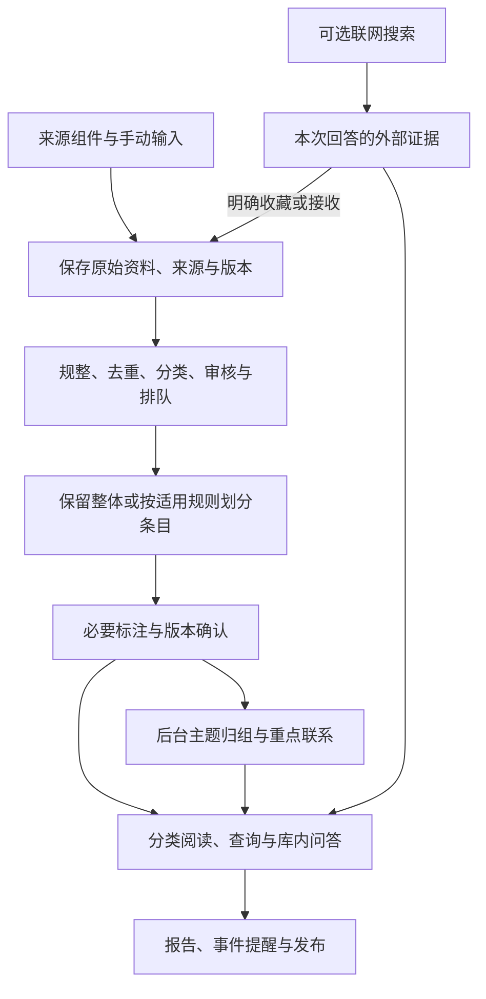

# StruInfo 内容系统重构实施方案

当前实现进度：P1–P4 已接入开发分支，使用合成资料验证。P4 用法见[结构化标注](structured-annotations.md)。
私人实例与内容库未切换；P5–P8 按下列计划继续。

- 日期：2026-10-23。
- 状态：八项产品方向已确认；P1–P3 已实现确认发布、来源接收与拆分方案。
- 范围：接收、拆分、标注、主题与联系、分类查询、报告发布、个人配置、新库切换。
- 当前交付：P1 内容发布闭环、P2 来源策略与接收管理、P3 来源拆分方案，见 [ADR 0088](adr/0088-confirmed-content-and-deferred-organization.md) 、[ADR 0089](adr/0089-source-receiving-strategies.md) 与 [ADR 0090](adr/0090-versioned-source-split-recipes.md)；不执行真实数据切换、部署或模型调用。

## 1. 目标与保留部分

资料按内容、更新规律和使用目的进入适合的流程。
快讯及时出现，教程保持连贯，周刊保留独立条目，工具和参考资料便于长期查找。
主题组织负责把相关内容放到一起，具体联系保存可核对的依据。

继续使用现有 TypeScript 模块化单体、PostgreSQL、外部 Blob 和个人配置边界。
复用原文保存、版本检查、人工接管、任务恢复、模型许可、价格窗口、费用记录、引用和导出。
HTTP、内置 AI、MCP 和页面继续调用同一组应用用例。
AI 不可用时，手动接收、分类、拆分、标注、查询和导出仍可完成。

保留已验收的工作区、字体、配色和交互材质。
界面随业务阶段调整分类、筛选、状态和入口，不重新展开视觉方案评选。
前端细则继续遵守[前端设计规范](frontend-design-specification.md)。

本方案描述目标行为与任务安排。
P1 已记录新发布边界并实现确认版本契约。后台归组算法及新 AI 流程留待后续阶段。
切换前的实例继续遵守现有运行规则；旧 ADR 和已保存任务的解释不被计划文字直接改变。

## 2. 目标流程与核心对象

高时效资料使用保留整体和最小标注流程，审核与发布检查仍然执行。
原文、工作草稿、正式发布版本分开；主题处理结果可以稍后补充。

| 对象       | 责任与身份规则                                                            |
| ---------- | ------------------------------------------------------------------------- |
| 来源配置   | 连接器实例、更新策略、历史能力、处理偏好；有稳定来源 ID 和配置版本        |
| 接收记录   | 某来源在哪次检查中提供了什么；保存外部 ID、游标及原始发布时间依据         |
| 原文版本   | 原始字节、正文投影与精确范围；版本不可覆盖，变化形成新版本                |
| 阅读条目   | 可独立理解的内容单元；属于明确原文版本，保留拆分与合并沿袭                |
| 检索片段   | 从条目派生的可重建索引单元；保留所属条目和上下文，不独立发布              |
| 分类与标注 | 内容形式、领域、对象、议题、用途和适用条件；保存依据及人工／规则／AI 来源 |
| 主题与成员 | 稳定主题身份、成员版本、纳入理由和证据；允许一条内容属于多个主题          |
| 具体联系   | 两端条目版本、关系类型与正文证据；与计算相似度、主题归属分开              |
| 发布记录   | 指向当前已确认的内容版本；草稿不会直接进入正式检索                        |
| 任务与费用 | 步骤、输入版本、策略版本、断点、授权和预算；重试复用原任务范围            |

同一文章被多个来源提供时，保留各自接收记录。
可复用相同原文，不丢失来源归属，也不直接把转载数量算成独立支持证据。
事件相同、内容相同和版本更新分别识别，不能只按标题相似就合并。

发布时间、事件时间、接收时间、最后核验时间分别保存。
未知时间允许为空；推断时间标注依据，不能用接收时间悄悄代替发布时间。

### 2.1 发布与后台任务

基础流程为审核通过、原文可追溯、条目结构有效、必要标注完成、版本确认。
通过后发布；无主题、无联系或主题任务失败不阻断基础内容使用。
必要标注由处理方案声明；允许明确的未知项，不要求模型填满全部维度。

接收决定、内容发布、主题处理、检索索引和报告发布各有独立状态。
页面分别显示“可阅读”“待归组”“归组失败”等实际结果，不以一个百分比代表全部流程。
有草稿时，正式查询使用最后确认版本；新版本确认后再替换发布指针。
首次未确认内容、被拒收内容和人工暂缓内容不能进入正式查询、问答或报告。

发布与后续待办的记录需可靠衔接，重启后能补做索引和归组，不能重复发布或重复计费。
检索结果必须检查发布版本和可见范围；旧索引不能使撤回或私密内容重新出现。
人工修改后的后台任务须核对输入版本；过期结果保留记录，但不覆盖新修改。

## 3. 接收框架与来源组件

### 3.1 组件、策略和能力

继续使用连接器接口，按 RSS、Git、JSON API、网页和已安装适配器划分接入方式。
每个具体来源创建配置实例，避免复制一套来源专用代码。
只有协议或提取结构确实不同且配置无法表达时，才增加适配器实现。

来源配置独立表达以下内容：

| 维度     | 配置内容                                                           |
| -------- | ------------------------------------------------------------------ |
| 更新策略 | 首次采集、周期检查、预期发布时间窗口、短间隔检查或受支持的事件通知 |
| 历史能力 | 是否有公开目录、分页、日期过滤、版本历史；只声明实际支持的能力     |
| 时间要求 | 可接受延迟、过期条件、历史补收与实时任务的优先级                   |
| 内容偏好 | 默认内容形式、适用拆分方案、接收偏好和目标阅读区域                 |
| 运行限制 | 单次数量、来源限速、重试退避、检查窗口、正文与请求容量             |

主动搜索是单独的查询任务；只有保存为明确的监测规则后才会周期运行。
页面展示最近检查、下次检查、最近更新、待审数量和抓取异常。
静态资料不持续空轮询；周期来源按时区和预期窗口检查，并处理漏跑。
实时目标取决于来源实际更新能力和配置间隔，不能把轮询描述为即时推送。

### 3.2 框架处理

接收流程依次完成原始保存、正文投影、身份与版本识别、重复检查、完整性检查、分类和分流。
正文规整保留标题、表格、图注、代码与来源映射，失败时保留原始材料及具体原因。
来源摘要、全文和外链目标分别标记；外链目标只有实际抓取后才能作为全文依据。
格式修复不补写缺失事实，不绕过付费或访问限制。

同一来源、外部 ID 和内容版本的重复接收应复用结果。
游标只在本轮内容持久保存后推进；部分失败保留成功记录，重试只处理缺项。
历史补收使用独立进度，不推进实时订阅游标，不改变来源启停状态。

### 3.3 评分与排队

偏好适配、采集完整性、事实可靠性依据和时效紧迫度分别记录。
人工接受率只能影响偏好适配；抓取失败单列为接入问题。
AI 自己的接受决定不能自动增加事实可靠性评分。
新来源使用中性起点；样本不足时展示不足，拒绝原因缺失时不推断用户偏好。

队列由紧迫程度、当前偏好、内容年龄和等待时间共同排序，保留排序原因。
实时、普通、历史补收共用执行器，通过来源限额和等待补偿防止某一类长期占满资源。
模型并发与抓取并发分别计数，模型部分继续受统一许可、价格窗口和预算控制。
接收可先完成，模型任务等待低价窗口；紧急模型调用需要已有明确策略和独立限额。

## 4. 来源适配与拆分方案

规则选择使用“来源默认方案 + 栏目或格式特征 + 单篇例外”。
同一来源允许同时拥有教程、公告和合集等多种方案，匹配不确定时不套用高风险规则。

通用模板覆盖整体保留、独立编号条目、独立标题条目和带说明的资源目录。
链接只是候选边界；正文中的普通链接和参考文献不能自动生成独立条目。
长教程仍是完整阅读条目，检索或模型输入需要的小片段单独派生。

AI 输出受限的规则建议：匹配特征、边界规则、附属内容归属和例外条件。
程序执行已知规则，不运行模型生成的任意脚本、网络请求或无限制表达式。
匹配资源也有执行限额，避免复杂规则阻塞接收。

方案经历草稿、试运行、启用、暂停和替代状态，保存规则版本及验证记录。
启用依据包含不同期数、不同栏目、已知异常样本和人工修正，不能只依据连续成功次数。
配置修改后只影响新任务；既有任务冻结自己的方案版本。

每次执行检查正文完整覆盖、无重复和顺序保持；标题属于本条，附属信息有明确归属。
条目数突变、模板匹配失败或正文覆盖异常触发复核或 AI 回退，显示具体原因。
保留人工指定边界和例外，自动学习只提出新草稿。

容量按正文、输入片段、独立条目和调用预算分别检查。
现有 64 条目／128 输入单元及已保存任务预算继续兼容；重构不默默提高限制。
超限合集采用可验证的有界子批或暂缓，子批共享原始文档和总预算。
不能通过截断全文或合并无关条目来满足限额。

## 5. 结构化标签与观点

用有角色的标注取代平铺词表，同时保留全文检索。
维度定义、个人词条、别名和权重存于外部工作区，通用示例不成为不可修改的分类常量。

| 维度     | 主要用途                             | 约束                           |
| -------- | ------------------------------------ | ------------------------------ |
| 内容形式 | 阅读和处理方式                       | 文档与内部条目可有不同形式     |
| 领域     | 稳定浏览入口                         | 可多选，区分主要与次要归属     |
| 具体对象 | 人、组织、工具、概念、事件等对象定位 | 名称相近不直接合并身份         |
| 核心议题 | 表达正文实际讨论的事情               | 不从参考链接或其他条目借用议题 |
| 使用目的 | 理解、实践、比较、追踪等使用入口     | 不把所有可能用途都填入         |
| 适用条件 | 时间、版本、地区和前提               | 允许未知，不强制猜测           |

单条标注保存稳定词条 ID、原始措辞、来源、输入版本和对应证据。
同义词和翻译可以共享身份；上下位与相关词保存不同关系。
同名异义词保留独立身份，待确认别名不直接改写检索或合并已有词条。
人工确认的别名与人工标签继续优先，文档标签概览和单条标签分别呈现。

观点单独记录主张、提出者、赞同／反对／转述、条件、时间和原文依据。
首版只提取明确表达的观点，不构建额外的自动事实裁决系统。
标注完成允许无标签或部分未知，但要显示状态；不能为了通过校验而生成无依据的标签。

## 6. 主题与重点联系

先用结构化标签、全文检索和可用的语义检索找候选，再交给 AI 检查主题与成员。
没有向量服务时保留标签和词法路径，不引入必需的新模型依赖。
候选阶段使用有界邻居列表，避免计算并保存全部标签对和全部文章对。

共现按独立阅读条目统计，同时限制同一文档、同一来源和转载的重复贡献。
合集中的不同新闻不因为同属一期就相互增加主题权重。
宽泛高频词降低区分权重，稀少共现保留样本数和不确定性。
时间、版本和具体对象参与筛选，避免把不同年代或不同版本的问题混成同一结论。

主题保存名称、范围说明、成员理由、证据和处理版本。
一条内容可属于多个主题；新增内容只触发受影响主题的增量检查。
主题概述标明所依据的成员版本，成员变化后标记待更新。
相似候选、已确认主题成员、具体文章关系分别展示，不合并成一种“联系”。

支持、反驳、延续、替代等重点联系按需求生成，并保存两端正文依据。
没有具体依据时保留主题归属或相似候选，不强求文章对关系。
人工固定成员、排除成员、手动关系和阻止建联记录优先于自动计算。
AI 主题判断和实测共现统计分开，禁止把模型推断作为新的独立共现样本循环加分。

主题任务单独显示费用，但仍归属明确的总预算，不能借拆成后台任务新增额度。
组级调用只结算一次；按文章分摊展示时不能重复计费。
输入版本、候选集和规则未变时复用已保存结果，失败不无限重跑。
质量检查分别看错误归组、遗漏、关系依据和使用价值，不以联系数量作为成功标准。

## 7. 分类存储、阅读与查询

首版继续使用单个活动 PostgreSQL 工作区和外部原文存储。
以逻辑区域、索引、版本和生命周期区分内容，不按类型部署多个独立数据库。

| 阅读区域示例 | 默认行为                                         |
| ------------ | ------------------------------------------------ |
| 动态与事件   | 按事件或发布时间排列，合并重复报道，展示后续状态 |
| 知识与方法   | 按议题、领域和相关性组织，保留完整解释与上下文   |
| 工具与资源   | 展示用途、版本、维护状态和适用条件               |
| 历史与归档   | 保存旧版本、过期内容与既有引用                   |

区域名称、筛选条件、排序、保留规则可配置，内容可出现在多个视图而不复制正文。
新闻可以长期保留，工具也可以过时；形式和保留期限独立决定。
到期默认降低展示优先级或归档，不直接删除被引用的原文。
已有报告和观点引用固定版本；归档、纠错和撤回保留可追溯说明。

增加未读、已读、收藏和稍后阅读等个人状态，独立于处理状态。
工作台继续负责编辑；数据阅览负责按类别、对象、主题和时间找到内容。
全文与条目保持从属关系，查询片段能回到完整文章及其精确位置。

库内检索可指定区域、内容形式、时间口径、来源、标签、主题和关系类型。
问答遵守同样的范围，不因证据少而悄悄扩大到全部资料。
跨区域查询需要显示类别、时间和版本，未知或过期状态可见。

联网扩展由独立搜索／抓取适配器提供，候选供应商包括已有 API 配置可接入的服务。
结果先成为本次回答的外部证据，标明来源和获取时间；收藏或接收后才进入持久内容流程。
库内、联网、混合模式可选，网络失败不影响库内检索。
私密文本不因开启联网而自动发送；外发内容沿用现有可见性和模型传输限制。
搜索摘要不足以支撑结论时，获取正文或明确指出材料不足，不声称读过未获取的文章。

## 8. 报告、提醒与发布

复用现有日报、周报、月报、专题、资料摘录、引用、Markdown 和打印 PDF 能力。
报告选材来自明确范围内的已发布版本，按事件或主题组织，保留选材截止时间。
新条目和归组更新不会悄悄改变已生成报告的引用内容。

生成与发布拆为两类任务，分别保存状态和失败原因。
定期报告按时区、时间窗口和稳定任务身份调度；漏跑后按配置补一次或跳过，不反复生成。
事件提醒处理去重、合并、频率限制、静默时间及更正，避免同一事件连续刷屏。
用户明确指定的急件先走基础提醒，深度总结等待获准的模型窗口。

首个可用版本完成站内提醒、报告队列与本地导出。
外部推送保留发布端口和配置边界；实际渠道与接收目标尚未选择，不擅自绑定或发送。
后续渠道采用稳定发布身份和送达记录；发送超时不能简单视为未送达并无限重发。

## 9. 个人配置、运行记录与代码边界

| 位置                   | 可保存内容                                                   |
| ---------------------- | ------------------------------------------------------------ |
| Git 与发行包           | 通用协议、状态机、连接器实现、无真实值的模板、合成样本和文档 |
| 外部个人配置           | 来源、拆分方案、维度与词表、排序、生命周期、模型与发布偏好   |
| 外部内容数据库与文件   | 原文、条目、标注、主题、联系、报告、人工决定和任务记录       |
| 外部运行配置与秘密引用 | 数据根、数据库连接、API 端点、密钥引用和运行参数             |

配置可导出、校验、迁移和恢复；替换个人配置无需修改源码或重新构建。
先校验完整配置再启用，失败保留原配置，并展示具体问题。
运行中的任务冻结配置与规则版本，后续配置变化不偷偷扩大旧任务预算或权限。
原文或模型回答中的指令不能修改来源、规则、授权和预算。

规则建议与已启用规则分开，AI 只能在已授权范围内提出或应用受约束变更。
手工决定、私密范围和已暂停任务不能因换库、恢复或部署自动被重置为允许。

## 10. 模块重组与复用安排

以下为逻辑责任划分，P1 冻结具体目录和接口。
继续在现有分层内调整，避免新增一套独立后台或两套长期并存的写入流程。

| 责任           | 现有起点                                                                     | 重构动作                                             |
| -------------- | ---------------------------------------------------------------------------- | ---------------------------------------------------- |
| 采集与调度     | `modules/subscriptions`、`platform/sources`、`source_subscription_scheduler` | 保留连接器；拆出能力声明、调度策略、游标与来源状态   |
| 审核与分流     | `document_intake_service`、`intake_feedback`、`source_quality_service`       | 分离偏好、完整性、可靠性依据和时间优先级             |
| 原文与内容     | `modules/evidence`、`modules/entries`                                        | 保留证据范围；补充内容版本、形式、用途和生命周期     |
| 来源规则       | `information_entry_split_rule`、`modules/processing`                         | 增加来源／格式方案、试运行、版本与漂移检测           |
| 标注与词表     | Entry 标签、别名与标注服务                                                   | 改为有角色的维度、词条身份、归属和证据               |
| 主题与联系     | 候选召回、规则联系、AI 联系提案                                              | 新增主题成员；重点联系选择性执行                     |
| 发布与任务     | `document_publication`、`agent_task_service`、预算与调度                     | 基础发布与后台任务分开，共用版本和费用检查           |
| 查询与报告     | Entry 查询、问答、`report_service`                                           | 分类视图、版本检索、事件选材和发布任务               |
| 页面与外部接口 | `apps/web/src/workspaces`、HTTP／MCP 应用命令                                | 使用同一业务契约，替换入口并移除确认无调用方的旧逻辑 |

每个阶段删除已被完整替代且无消费者的实现，保留确有恢复或接口消费者的兼容代码。
旧 MCP 客户端和数据包采用明确版本处理；不悄悄改变相同字段的意义。
新工作区不要求复制全部旧业务表，但原始迁移文件和已发布数据包格式不能原地改写。
旧库读取／恢复可由保留的旧版镜像承担，避免把全部历史任务语义带入新主线。

## 11. 数据封存、切换与回退

本节为实施时操作顺序；本轮只制定方案。

1. 记录旧实例版本、数据库、Blob 根、配置和正在执行的任务；运行记录留在仓库外。
2. 停止旧实例新增采集、模型和报告任务，等待在途请求结束；保存终态、未知费用和断点。
3. 一致备份数据库、原文、附件、个人配置和恢复所需的密钥引用；秘密本身按现有安全方式保存。
4. 在隔离环境恢复，核对原文、人工决定、报告引用和配置；确认可读后封存为只读档案。
5. 用新工作区身份、新数据库和独立外部数据根建立空内容库，避免与旧 Blob、游标和任务混用。
6. 按明确清单导入可复用的来源、显示、词表和人工偏好，保留来源反馈的历史身份；不自动搬入旧内容、任务或旧预算。
7. 新库初始关闭自动接收、模型与对外发布；用合成材料验证，再在固定公开清单与独立预算内完成验收。
8. 原子切换有效配置和启动入口，验证 UI、HTTP、MCP、查询、导出和恢复入口；旧实例继续只读。
9. 验收后将旧数据库从主应用连接与写入范围中移除，保留可恢复档案和旧镜像。

封存时决定未完成任务取消或保留为历史断点，不把旧任务直接指向新库继续执行。
偏好迁移采用明确字段清单；拒绝记录不能变成新资料的接受决定，未知来源对应关系留待处理。
旧来源的历史补收范围和初始游标需显式设置，不能因空游标自动重收整个网站。
旧授权和密钥文件保留，但新工作区授权须重新校验绑定，不能因复制配置而扩大访问。

回退时先停止新库写入、保留新库数据与任务，再将旧镜像连接回经过验证的旧配置。
新库接受的内容不得丢弃，也不自动反向写入旧库；需要回迁时另做版本化导出与选择导入。
“移除现有数据库”落实为移出活动实例，唯一恢复副本不在本次切换中删除。
不因更换实例而复制已发送消息或恢复已暂停的预算。

## 12. 开发顺序与阶段交付

每个阶段交付可运行的功能、对应测试、必要页面入口和更新后的使用说明。
阶段内部不只堆叠抽象协议；尽早贯通接收一篇合成资料到查询的路径。

| 阶段                  | 主要工作                                                                         | 验收出口                                                                 |
| --------------------- | -------------------------------------------------------------------------------- | ------------------------------------------------------------------------ |
| P0 方案整理           | 确认八项方向、范围、顺序和验收表                                                 | 本文件及规范入口；已完成                                                 |
| P1 内容模型与最小闭环 | 接续 ADR、身份与时间字段、草稿／发布状态、新库初始化、共享 HTTP／MCP 契约        | 在一次性空库中手工导入、确认并查询一篇合成资料；后台归组失败不影响读取   |
| P2 接收与来源管理     | 组件能力、更新策略、身份去重、历史与实时队列、评分分离；已实现，见 ADR 0089      | 同源重复拉取不重复入库，历史补收不推进实时游标，可见下一次检查与等待原因 |
| P3 来源拆分方案       | 来源／格式匹配、AI 规则草稿、试读启停、覆盖校验与回退；已实现，见 ADR 0090       | 连贯教程完整，合集独立，格式变化触发复核，手工边界保留                   |
| P4 标注与分类阅读     | 维度、词表、别名、观点、用途与阅读状态；基础分类查询                             | 同义检索有效，同名异义不混并；无标签和未知状态可用；确认后可分类阅读     |
| P5 主题与重点联系     | 有界候选、主题成员、增量总结、选择性联系、后台预算和状态；已实现，见 ADR 0092    | 主题可解释，跨版本结果不覆盖人工修改，既有结果不重复调用，基础发布独立   |
| P6 联网、报告与发布   | 证据范围、DeepSeek 联网、事件归并、定期生成、站内提醒、导出；已实现，见 ADR 0093 | 网络故障不影响库内搜索；报告引用固定；定时任务不重复生成和发布           |
| P7 封存与新库切换     | 恢复演练、配置迁移清单、备份、固定小批验收、切换与回退验证                       | 旧库可恢复、新库可用、运行范围明确；不自动启动剩余历史批次               |
| P8 清理与交付         | 删除已替代路径、更新 README／运维与接口文档、完整回归、发行准备                  | 用户能按文档完成接收、整理、查询、报告与恢复；无两套活动写入主线         |

P1 开工清单：

- 盘点现有消费者，明确继续支持的 HTTP／MCP 和备份格式，以及旧镜像承担的恢复范围。
- 接续 ADR 0085，记录基础发布与后台归组分离；现有稳定运行实例在切换前继续按旧规则运行。
- 定义来源、原文版本、阅读条目、检索片段、标注和发布指针契约，补上独立时间字段。
- 在一次性外部数据库中验证初始化、幂等导入、手工确认、查询和重启恢复。
- 明确每个后续模块调用的应用用例与版本检查，禁止页面或模型适配器直接写正式内容。

默认先完成 P1–P4 的可用闭环，再推进 P5–P6。
P5、P6 的模型／联网服务使用合成替身完成工程验证，真实调用留到明确的有限验收。
发布与主题任务拆分后，仍保留当前实例设置的并发、价格和重试限制；不借重构提高调用额度。
阶段交付不自动授权提交、推送、发布新版本或启动下一批资料。

## 13. 验收、费用与停止条件

### 13.1 功能与数据完整性

| 场景                         | 必须观察到的结果                                                                       |
| ---------------------------- | -------------------------------------------------------------------------------------- |
| 同一来源同时提供教程与周刊   | 匹配不同方案，教程完整、周刊独立条目可读                                               |
| 原始抓取不完整或规则失配     | 保留原文及原因；不凭空补正文、不静默发布                                               |
| 重复拉取、任务中断、再次启动 | 身份和进度复用，不重复发布或越过未保存内容；已保存成功回答不重发，未知响应保留费用预留 |
| 多来源转载与同一期合集       | 不因来源数或同刊共现虚增主题支持                                                       |
| 人工编辑后旧 AI 回答到达     | 记录版本冲突，不覆盖手工结果                                                           |
| 宽泛词、翻译别名与同名对象   | 别名按确认规则生效；相关词不冒充同义词                                                 |
| 主题为空或归组失败           | 基础内容可查询，后台状态和费用单列                                                     |
| 历史补收和事件后续更新       | 历史不冒充新消息；后续信息保留时间与版本关系                                           |
| 私密、暂缓、拒绝、撤回内容   | 查询、主题、报告和联网边界一致，无旧索引泄露                                           |
| 定期报告与发送超时           | 同一周期身份稳定，送达不确定可见，重试不无限重复发送                                   |
| 新旧库切换与回退             | 配置、数据库、原文根和工作区身份一致；两侧新增记录均可保留                             |

### 13.2 有限真实验收

工程验证先用合成数据完成，真实资料和报告留在仓库外。
首轮真实验收建议固定 20 篇，覆盖连贯长文、合集、短技术内容、动态、资源、重复和版本变化。
可以复用已保留的公开原文，避免无关抓取变化影响比较；不把真实原文移入测试夹具。
来源、正文版本、规则版本、模型配置、总预算、每项调用上限和终止条件在运行前冻结。
旧试运行预算保持暂停，新验收单独记账；材料与预算未明确前不启动付费请求。

同时记录以下结果：

- 基础流程完成、合理暂缓、失败、等待价格窗口，分别统计。
- 原文覆盖、独立条目边界、标注依据、错误归组和全部新增正向关系的证据。
- 接收到可阅读的时间、单篇处理时间、排队时间和每阶段模型调用量。
- 模型输入／输出用量、已知估算费用、未知费用预留及主题阶段费用占比。
- 已发布条目、实际可用主题和报告的使用价值，不以标签数或关系数评优。

工程通过率和语义抽检结论分开报告；新旧结果应比较相同材料和相同使用目标。
长合集与短文分别展示成本；关系变化后不能仅用单次调用价格宣称整体更便宜。
该轮结束给出通过、需修复或保留例外的结论，不补位、不自动扩额或循环追加调优轮次。

### 13.3 检查与交付

行为修改运行相关单元和集成回归；页面变更运行相关浏览器场景并检查实际布局。
切换或发行准备执行现有完整质量门禁、合成数据库／浏览器、备份恢复和制品检查。
新增依赖遵守[开源政策](open-source-policy.md)，不把整库重构当作任意升级依赖的理由。
仅文档的 P0 检查 Markdown、相对链接、阶段一致性和差异，不调用模型或运行生产迁移。

按[开发规范](development-standards.md)区分可复现的产品阻断、后续加固和环境未就绪。
丢原文、越权发布、泄露私密内容、覆盖人工修改、失控重试或预算越界必须停止相关流程并修复。
模型服务故障、合理暂缓和可解释的语义差异单列处理，不通过重选样本掩盖结果。

## 14. 规范入口

- [产品需求](product-requirements.md)：用户目标与行为边界。
- [知识核心架构](knowledge-core-architecture.md)：当前实现与接续决策入口。
- [路线图](roadmap.md)：当前开发顺序。
- [项目状态](current-project-state.md)：已实施和未实施部分。
- [开发规范](development-standards.md)：模块、数据和验证规则。
- [统一文档发布决策](adr/0085-document-publication-lifecycle.md)：切换前仍执行的发布边界。
