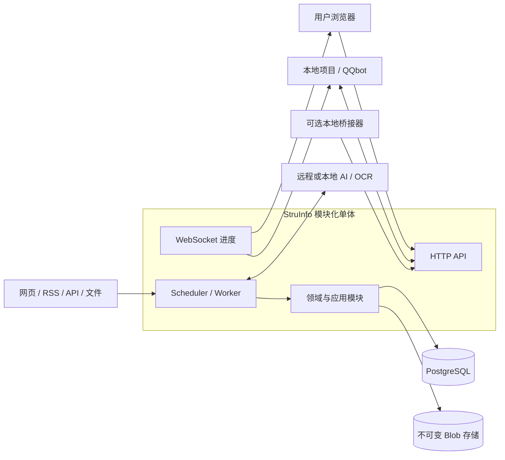

# StruInfo 开发大纲

- 状态：架构提案，待用户确认后进入脚手架阶段
- 最近更新：2026-08-02
- 对应需求：[产品需求](product-requirements.md)
- 对应计划：[分阶段计划](roadmap.md)
- 基础 ADR：[ADR 0001](adr/0001-typescript-modular-monolith.md)、
  [ADR 0002](adr/0002-postgresql-persistence-and-durable-work.md)

## 1. 结论

StruInfo 首版采用“单仓库、模块化单体、多运行角色”架构。

推荐技术方向是：

- Node.js 24 LTS 与严格模式 TypeScript 作为主要运行时和语言；
- React 与 Vite 提供浏览器界面；
- NestJS 只负责应用装配、HTTP、WebSocket 和运行时适配；
- PostgreSQL 18 保存业务真相，`pgvector` 只保存可重建的向量索引；
- Drizzle ORM 提供薄、类型安全的 SQL 与迁移层，并保留显式 SQL 通道；
- `pg-boss` 在 PostgreSQL 中提供定时任务、重试和后台执行；
- 原始网页、文本和图片进入内容寻址的 Blob 存储，不塞入关系表；
- AI、OCR 和未来的视频处理通过稳定接口接入，不能直接修改正式知识；
- Windows 开发与 Linux 部署使用相同数据库和迁移，不以 SQLite 模拟生产；
- 首版不引入微服务、图数据库、独立搜索集群、Redis 或平台专属 QQ 逻辑。

该方向仍是 `Proposed`，不是已经接受的实现许可。
确认本文第 17 节的三个问题、完成三个技术探针并接受 ADR 后，才建立源码脚手架。

## 2. 为什么选择这个形态

StruInfo 的主要复杂度来自证据版本、知识修订、长任务恢复、幂等、审计和外部集成，而不是请求吞吐量。
在这些边界尚未被真实使用验证时拆成微服务，会把模块调用变成网络调用，并提前增加部署、追踪和一致性成本。

模块化单体保留清楚的领域边界，同时允许同一构建产物按不同角色启动：

- 开发阶段可在一个进程中同时运行 API、调度与 Worker；
- Linux 正式环境可拆为 API、Scheduler 和 Worker 进程；
- 角色拆分不改变模块接口，也不要求立即拆仓库或拆数据库；
- 只有出现独立扩缩容、隔离或发布节奏证据时，才考虑提取服务。

TypeScript 相比 Python 主后端，避免 Windows 后台任务生态差异，也保留良好的网页采集、流式 AI 和全栈开发体验。
相比 C#/.NET，TypeScript 能让前端、后端、契约和大多数适配器共用一种语言，降低个人项目的上下文切换。
.NET 10 LTS 仍是可信备选；如果维护者明显更熟悉 C#，或首版需要 Windows Service 和大量进程内 CPU 工作，应重新评审 ADR 0001。

## 3. 系统上下文



生产环境需要访问用户本地项目时，本地桥接器主动建立受认证的出站连接。
云端服务不得主动扫描或直接暴露用户局域网。

## 4. 核心工程原则

1. 来源、快照、AI 产物与正式知识分层保存。
2. 领域规则不依赖 NestJS、数据库、模型供应商、文件路径或 QQ API。
3. 模块只能通过公开应用接口协作，不能跨模块直接改表。
4. HTTP 是命令与查询的权威接口；WebSocket 只是可丢失的实时视图。
5. 任务与事件按可能重复执行设计，副作用由幂等键和唯一约束保护。
6. 索引、向量和树视图都是可重建派生物，不是知识真相源。
7. 外部网页、模型输出和媒体文件都是不可信输入。
8. 先完成一个真实信源的纵向闭环，再扩展格式、连接器和自治能力。

## 5. 模块边界

| 模块 | 拥有的数据与职责 | 明确禁止 |
| --- | --- | --- |
| `access` | 用户、工作区、会话、权限和策略 | 把单用户假设写成无工作区的数据模型 |
| `sources` | Watch、Endpoint、抓取计划、游标和来源适配器 | 直接产生正式知识 |
| `evidence` | Resource、Snapshot、Fragment、Blob 元数据和证据定位 | 覆盖不可变快照 |
| `processing` | Operation、AI/OCR 运行、CandidateProposal 和插件编排 | 直接创建 Candidate 或 KnowledgeRevision |
| `knowledge` | Candidate、KnowledgeItem、Revision、Citation、Relation 和审核 | 让来源适配器直接改知识表 |
| `retrieval` | 过滤、关键词、向量、树、时间线和混合查询 | 把索引当成唯一数据副本 |
| `digests` | 日报/周报、时间窗口、排序和 Delivery | 在渠道适配器中编排业务摘要 |
| `integrations` | HTTP 契约、WS 事件、Webhook 订阅、投递和外部项目授权 | 在核心中加入 QQ 平台细节 |
| `platform` | 数据库、Blob、队列、事务性 outbox、配置、日志、指标和秘密引用 | 承载产品领域规则 |

每个业务模块内部按需要分成 `domain`、`application`、`ports` 和 `adapters`。
不为没有第二种实现或清楚测试价值的对象提前创建接口。

## 6. 关键数据流

### 6.1 采集与入库

```text
Watch / Endpoint
  -> FetchRun
  -> Resource
  -> immutable Snapshot
  -> Fragment
  -> ProcessingRun
  -> CandidateProposal
  -> Candidate
  -> user approval
  -> KnowledgeItem + KnowledgeRevision + Citation
  -> transactional outbox event
```

来源适配器的终点是 `Snapshot`，不是 `KnowledgeItem`。
AI 的终点是有证据的 `CandidateProposal`；`processing` 通过 `knowledge` 的应用接口把有效提案登记为 `Candidate`。
正式知识只能由 `knowledge` 模块的批准用例创建。

### 6.2 查询

```text
query request
  -> choose private / live web / hybrid scope
  -> retrieve revisions and fragments
  -> optionally fetch and snapshot live evidence
  -> AI synthesis
  -> citation and evidence validation
  -> answer + per-claim citations + uncertainty
```

实时网页只有先产生快照和片段，才能转成候选或支持可保存回答。

### 6.3 报告与推送

```text
schedule window
  -> select new candidates
  -> deduplicate and rank
  -> generate cited digest
  -> persist Digest
  -> enqueue outbox event
  -> signed Webhook delivery
  -> receiver deduplication by event_id
```

日报和投递分别记录状态。
成功生成报告不等于成功送达，推送失败也不能让报告消失。

## 7. 状态与幂等模型

不要用一个“处理中/完成”状态覆盖整个链路。

```text
Operation: queued -> running -> retry_wait -> running
                              -> succeeded | failed | cancelled

Candidate: pending_review -> approved | rejected | superseded

Delivery: pending -> sending -> delivered
                            -> retry_wait -> sending
                            -> dead_letter
```

公开的 `Operation` 记录业务阶段、进度、父任务、尝试次数、下一次重试、错误码和关联 ID。
`pg-boss` 负责耐久调度与任务领取，但其内部 ID 不作为公共 API 的稳定标识。

实现约束：

- 所有外部可重试写操作接受 `Idempotency-Key`；
- 更新知识时携带修订号或 `ETag/If-Match`，避免静默覆盖；
- Worker 可能在超时或崩溃后再次执行，处理器必须幂等；
- 入库变更与 outbox 事件在同一 PostgreSQL 事务提交；
- Webhook 至少一次投递，接收方按稳定 `event_id` 去重；
- 对发送消息等外部副作用，不宣称端到端“恰好一次”。

业务模块在 Unit of Work 中通过端口登记领域事件或后续任务，不直接写 `platform` 表。
PostgreSQL 适配器在同一事务中提交业务变更，并分别把内部后台工作写入 `pg-boss`、把需要送往外部的事件写入 outbox。
Outbox Delivery Worker 直接租用 outbox 行并执行 Webhook 投递，不再把同一外部事件复制到第二条队列。

计划时间使用 IANA 时区名称，实际执行时刻保存为 UTC 瞬间。
遇到 Windows 休眠、停机或夏令时变化时，日报类任务默认只补跑一次最近遗漏窗口，不批量重放每个错过的触发点；具体 Watch 可以显式改为跳过。

## 8. 持久化与检索

### 8.1 PostgreSQL

Windows 开发与 Linux 正式环境都使用 PostgreSQL 18。
这样可以在进入生产前真实验证事务、约束、递归查询、任务领取、中文检索和向量行为。

Drizzle 作为薄 SQL 层的候选原因是它支持 PostgreSQL、显式迁移和 `pgvector` 类型及索引。
复杂查询允许使用有参数绑定、有集成测试的原生 SQL，不为了 ORM 纯洁性隐藏数据库能力。

关系表保存：

- 工作区、来源、抓取运行和游标；
- 快照与片段元数据；
- AI/OCR 运行、候选和审核；
- 知识项、不可变修订、引用、派生与关系；
- 树位置、报告、投递、操作、outbox 和审计；
- Blob 的逻辑 ID、内容哈希、大小、类型和保留状态。

所有私有业务记录都带工作区边界，唯一约束与查询不能只依赖调用方记得过滤。
时间字段使用 `timestamptz` 表示确定瞬间，同时保留原始时区、精度和是否由 AI 推断；发布时间、事件时间、有效时间、抓取时间和入库时间继续分列。
Snapshot 分别记录原始响应哈希和规范正文哈希，正文规范化算法也需要版本，避免把版式变化误判为知识变化。

### 8.2 Blob 存储

大文本、原始响应、图片和未来视频保存为不可变 Blob。
首版实现本地文件系统适配器，文件名由内容哈希派生，业务记录只引用逻辑 Blob ID。

Linux 单机部署可先使用受备份保护的持久卷。
需要多机或对象存储服务时，再增加 S3 兼容适配器；迁移不能改变 Resource、Snapshot 或 Citation ID。

不可变表示已保存的字节不会被原地改写，不表示永不删除。
每个逻辑 Blob 都属于工作区，并通过显式引用与 Snapshot、Fragment 或处理运行关联；失去全部有效引用且超过保留期后才能进入垃圾回收。
删除请求立即撤销普通读取并留下审计状态，物理字节和备份副本按公开的清理窗口删除；不能把异步清理描述成即时物理擦除。

### 8.3 搜索

搜索按证据逐步升级：

1. MVP-0 使用结构化过滤、标题/正文子串和来源、时间筛选；
2. 用真实中文样本评估 `pg_trgm` 的召回率与索引大小；
3. 需要语义检索时，在 PostgreSQL 中启用 `pgvector`；
4. 混合排序同时保留关键词得分、向量得分和过滤原因；
5. 只有单库检索无法达到已量化目标时，才评估独立搜索引擎。

知识关系先用带方向、类型、版本和审核状态的关系表表达。
树视图使用 `TreePlacement`，递归查询不足以满足真实规模前不引入图数据库。

## 9. AI、中文与媒体处理

### 9.1 AI 边界

应用层定义小而稳定的能力接口，例如：

- `TextGenerationProvider`；
- `EmbeddingProvider`；
- `DocumentExtractor`；
- `OcrProvider`；
- `MediaProcessor`。

每次处理至少记录：供应商、模型、提示模板版本、参数、输入引用与哈希、原始输出、规范化输出、耗时、用量、费用、警告和错误。
模型输出必须通过运行时 schema 校验；引用还要核对目标修订和片段是否存在，不能只相信模型给出的 URL 或片段编号。

外部内容只能进入不可信数据区，不能覆盖系统指令、扩大工具权限或选择任意网络与文件目标。
模型适配器不能直接写正式知识，也不能读取未被本次任务授权的工作区或 Blob。

### 9.2 中文

所有文本、JSON、数据库连接和导出统一使用 UTF-8。
分段、长度预算和引用位置不能以 JavaScript UTF-16 下标冒充 Unicode 字符或 UTF-8 字节位置。
Fragment 需要记录定位方案和版本，例如规范文本字符区间、DOM 路径、页码与图片区域。

中文搜索与分段必须用真实语料做验收，不能把英文分词效果外推到中文。
测试样本至少覆盖简体中文、中文与英文混排、全角标点、Emoji、不同 Unicode 规范化形式和时区文本。

### 9.3 图片与未来视频

首版对图片先做到：保存原始字节、类型、尺寸、来源位置、内容哈希和可回看的证据锚点。
需要图片理解时，可由多模态模型或 OCR 适配器产生派生文本和区域引用，但原图始终是证据。

视频在首版只允许作为 Blob 保存，不承诺解析。
真实样本证明需要视频后，再增加独立媒体 Worker，并用时间范围、转写片段和关键帧作为 Fragment。
包含原生依赖、GPU 或不可信解码器的 OCR/视频能力优先放入隔离进程；Python Worker 只返回结构化候选，不拥有知识业务规则。

## 10. 外部接口

### 10.1 HTTP

权威接口使用 `/api/v1`，以 OpenAPI 作为可测试契约。
首个纵向切片预计需要：

- 创建和查询信源；
- 手工触发采集并查询 Operation；
- 查看快照、片段和候选；
- 批准、编辑后批准或拒绝候选；
- 查询已保存知识和证据；
- 查询日报及投递状态。

长操作返回 `202 Accepted`、公开 `operation_id` 和状态资源位置。
错误响应使用稳定错误码、关联 ID 和可安全展示的信息，不泄漏凭据、私有正文或内部堆栈。
外部契约以 OpenAPI 和 JSON Schema 为准，不能让其他项目直接依赖服务端内部 TypeScript 类型。

### 10.2 WebSocket

WebSocket 只推送 `operation.progress`、`candidate.ready`、`digest.ready` 等实时视图；底层传输即使全双工，也不开放 WS 业务命令。
客户端断线或丢帧后必须能通过 HTTP 读取最终状态；高权限修改仍走经认证和幂等保护的 HTTP 命令。

握手需要认证并绑定工作区，浏览器连接校验 `Origin`，每条订阅再次执行资源授权。
连接数、订阅数、消息大小和发送速率都有上限，进度载荷默认不包含原始私有正文。

首版优先 NestJS 的原生 `ws` 适配器，不引入 Socket.IO 专属协议。
若后续证明确实需要房间、自动回退或复杂重连语义，再通过 ADR 评审。

### 10.3 Webhook 与本地项目

Webhook 包含版本、事件 ID、产生时间、工作区、资源 ID 和资源版本。
投递使用 HMAC 签名、时间戳、短重放窗口、指数退避和死信状态。

局域网内的现有项目通过受认证 HTTP 收发命令和查询，通过 WS 观察进度。
本地服务默认只监听回环地址；监听局域网地址必须显式配置允许来源、认证和防火墙规则。
浏览器写操作即使只在本机使用，也需要会话认证与 CSRF 防护。

QQbot 继续作为独立项目。
它消费通用 Webhook 或调用 HTTP API，不把 QQ 协议、消息格式和身份规则放进 StruInfo 核心。

## 11. 运行与部署

### 11.1 Windows 开发和测试

推荐形态：

- Node.js 和前端开发服务器在 Windows 原生运行；
- PostgreSQL 18 + pgvector 通过 Docker Desktop/WSL2 运行；
- Blob 使用仓库外、配置明确的本地数据目录；
- API、Scheduler 和 Worker 默认合并启动，故障测试时再分角色；
- 端到端测试使用 Playwright 的 Chromium，并在 CI 补充 Linux。

如果不能使用 Docker，使用原生 PostgreSQL 18 + pgvector 安装作为备选。
不因为本地安装方便而改用 SQLite，避免把兼容性风险推迟到部署阶段。

### 11.2 Linux 正式部署

第一种正式形态是单台 Linux 主机上的容器化部署：

```text
reverse proxy / TLS
  -> web static assets
  -> API role

PostgreSQL + pgvector
  <- Scheduler role (single active instance)
  <- Worker role (one or more instances)
  <- outbox delivery worker

persistent Blob volume + encrypted backup
```

API、Scheduler 和 Worker 使用同一后端镜像与代码版本，只改变启动角色。
部署必须包含数据库迁移、健康检查、优雅停止、资源限制、日志保留、备份与恢复演练。

应用 schema、扩展和 `pg-boss` schema 由独立迁移角色在服务启动前升级。
普通 API/Worker 角色只获得运行所需的最小 DML 权限；技术探针必须证明预建 schema 后启动不会要求普通角色执行 DDL，否则不能接受当前队列方案。

生产反向代理、云供应商、备份目标和秘密管理产品等供应商选择延后到部署 ADR。

## 12. 建议仓库布局

ADR 接受后再创建以下源码布局：

```text
apps/
  server/
    src/
      entrypoints/
      modules/
        access/
        sources/
        evidence/
        processing/
        knowledge/
        retrieval/
        digests/
        integrations/
      platform/
  web/
packages/
  contracts/
  test_support/
docs/
  adr/
```

`apps/server` 生成 API、Scheduler 和 Worker 入口。
`packages/contracts` 只保存有明确版本和所有者的共享契约，不成为任意通用工具的堆放处。

文件与标识符遵循 Google TypeScript Style Guide，包括 UTF-8、ES 模块、ASCII 标识符和 Google 命名规则。
框架生成的默认命名与 Google 文件名规则冲突时，以记录在 ADR 中且由工具统一执行的项目规则为准。

## 13. 工具链与质量门

拟采用：

| 目的 | 工具与约束 |
| --- | --- |
| 包管理 | pnpm workspace；唯一 `pnpm-lock.yaml`；`packageManager` 固定版本 |
| 编译与类型 | TypeScript 严格模式；`tsc --noEmit` |
| 格式 | Prettier，配置固定且不手工争论等价格式 |
| 静态检查 | ESLint + typescript-eslint 类型感知规则 + 模块边界规则 |
| 单元/集成 | Vitest；时钟、网络、模型和随机值均可注入 |
| 浏览器 E2E | Playwright，首轮 Chromium，CI 覆盖 Windows 与 Linux 关键路径 |
| 数据库 | 只提交前向迁移；测试实际执行升级、回滚策略和恢复 |
| API 契约 | OpenAPI 快照与兼容性测试；事件使用版本化 JSON Schema |
| 依赖 | 精确锁定、`pnpm audit`、许可证审查和发行前 SPDX SBOM |

在 ADR 接受后的脚手架提交中，根命令必须提供：

```text
pnpm format
pnpm lint
pnpm typecheck
pnpm test
pnpm test:integration
pnpm test:e2e
pnpm verify
```

`pnpm verify` 是本地与 CI 的统一合并门，不能依赖已登录浏览器、实时网站或真实 AI 供应商。

## 14. 测试策略

### 单元测试

- 知识修订、引用继承、审批、撤回和关系不变量；
- Operation、Candidate 和 Delivery 状态机；
- 去重、时间窗口、时区和幂等规则；
- 模型输出 schema 与引用核验；
- SSRF 地址判断、路径规范化和权限策略。

### 集成测试

- PostgreSQL 18 的约束、迁移、事务与并发任务领取；
- Blob 写入、按哈希去重、读取和损坏检测；
- 抓取、AI、OCR、Webhook 与 WS 各自使用可控测试适配器；
- 同一事务内的知识写入、任务发送和 outbox；
- 中文子串、`pg_trgm` 与后续向量检索基准。

### 纵向 E2E

固定许可的 RSS fixture 经过：

```text
fetch -> snapshot -> fragment -> cited candidate -> digest
      -> approve -> retrieve -> webhook
```

测试重复抓取、重复批准、重复事件、进程重启、AI 超时、发送确认丢失和 Windows 休眠后的补跑。
真实外部模型只做显式启用的 smoke test，不进入默认 CI。

## 15. 安全、隐私与运维门槛

进入相应功能前必须完成：

- 首个浏览器切片前：本地会话认证、写操作 CSRF、WS 认证与 Origin/工作区授权；
- 任意 URL 抓取前：SSRF 威胁模型、DNS/跳转复查、内网阻断、大小和超时限制；
- 外部 AI 前：按工作区配置的数据外发策略、最小输入、日志脱敏和删除策略；
- 公网部署前：公网身份策略、TLS、速率限制、秘密管理、备份和恢复演练；
- Webhook 前：签名、轮换、防重放、幂等和死信处置；
- 本地桥接前：出站连接、能力级授权、路径边界、撤销和审计；
- 媒体解析前：类型嗅探、解压炸弹、路径穿越、资源预算和解码器隔离。

任何自动化都需要预算、超时、并发上限、暂停开关、审计和回滚路径。

## 16. 实施顺序

### 准备门：接受架构

交付：

- 确认第 17 节问题；
- 完成第 16.1 节定义的三个技术探针；
- 将通过评审的 ADR 改为 `Accepted`；
- 建立工具链、目录、数据库迁移、CI 和依赖记录。

### 16.1 三个阻塞技术探针

| 探针 | 内容 | 通过条件 |
| --- | --- | --- |
| P1 平台与恢复 | 在 Windows 和 Linux 运行同一 Node/Nest/PostgreSQL/Drizzle/pg-boss 样例；中途终止 Worker；用迁移角色预建 schema | 任务安全恢复且不重复写知识；普通运行角色不需要 DDL |
| P2 中文证据 | 处理中文、英文混排、Emoji 和图片区域 fixture；保存、重启、导出后重新定位 Fragment；测量基础搜索 | 引用逐字返回原证据；偏移定义无歧义；记录中文搜索基线 |
| P3 协议与幂等 | 模拟 WS 断线、重复批准、Webhook 丢失确认和重复投递 | HTTP 可恢复最终状态；业务副作用各发生一次；失败状态可观察 |

许可证核验、精确版本固定、备份恢复和工具命令属于 ADR 接受检查与后续合并门，不另计为“第四个探针”。

### 切片 A：手工输入到可追溯候选

交付：

- 工作区、Operation、Blob、Resource、Snapshot 和 Fragment；
- 本地会话认证、浏览器写操作 CSRF 防护和 WS Origin/授权检查；
- 手工粘贴文本或提交固定 fixture；
- fake AI 与一个真实 AI 适配器；
- 带证据的 Candidate 页面；
- Windows 与 Linux 集成测试。

退出条件：中文摘要中的每项引用都能稳定返回原始片段，重复处理不产生重复候选。

### 切片 B：一个 RSS 信源到批准入库

交付：

- 一个公开 RSS/Atom Endpoint；
- 定时抓取、内容哈希、游标、重试和补跑；
- 最简日报；
- 批准、拒绝、纠错和 KnowledgeRevision；
- 已保存列表与关键词找回。

退出条件：满足产品需求中的 MVP-0 验收场景。

### 切片 C：稳定推送与第二信源

交付：

- 第二个真实信源；
- Webhook outbox、签名、重试与死信；
- QQbot 只读推送；
- 变化检测、更新候选与受影响知识复核；
- 导出、备份和恢复演练。

退出条件：连续运行一周无静默漏抓、重复入库或无法解释的投递状态。

### 后续切片

按真实使用依次加入混合查询、知识树/时间线、云端公开访问、本地桥接、图片 OCR、视频和受控自动发现。
顺序由样本和指标决定，不并行建设所有远期能力。

## 17. 接受架构前需要用户确认

以下三个答案会改变脚手架或安全边界：

1. Windows 开发机是否允许使用 Docker Desktop/WSL2 运行 PostgreSQL 18 + pgvector？
   推荐答案是允许；否则使用原生 PostgreSQL，但仍不切换 SQLite。
2. 私有知识是否允许按工作区配置发送给外部 AI API？
   推荐答案是“默认禁止，用户显式允许；同时保留本地/自托管适配器”。
3. 是否接受 TypeScript 作为主后端语言，且当前没有明显更强的 C# 团队偏好？
   推荐答案是接受；如果维护者主要熟悉 C#，应在搭脚手架前改选 .NET 10 LTS。

以下信息不阻塞架构文档，但阻塞首个真实功能切片：

- 第一个主要信源、一个备选信源和至少 10 条样本；
- 理想日报样例与“入库/只报告/忽略”标注；
- 现有 QQbot 是接收 Webhook，还是主动调用 StruInfo；
- 快照保存全文、正文、截图或引用片段的授权与保留期限；
- 图片在首批样本中的比例，以及是否必须从第一版读取图片文字。

## 18. 参考资料

- [Node.js 发布与 LTS 状态](https://nodejs.org/en/about/previous-releases)
- [Google TypeScript Style Guide](https://google.github.io/styleguide/tsguide.html)
- [NestJS 文档](https://docs.nestjs.com/)
- [NestJS WebSocket Gateways](https://docs.nestjs.com/websockets/gateways)
- [NestJS OpenAPI](https://docs.nestjs.com/openapi/introduction)
- [React 版本](https://react.dev/versions)
- [Vite 指南](https://vite.dev/guide/)
- [pnpm Workspaces](https://pnpm.io/workspaces)
- [PostgreSQL 版本支持](https://www.postgresql.org/support/versioning/)
- [PostgreSQL `pg_trgm`](https://www.postgresql.org/docs/current/pgtrgm.html)
- [pgvector](https://github.com/pgvector/pgvector)
- [Drizzle PostgreSQL extensions](https://orm.drizzle.team/docs/extensions)
- [pg-boss](https://github.com/timgit/pg-boss)
- [Playwright 安装与平台支持](https://playwright.dev/docs/intro)
