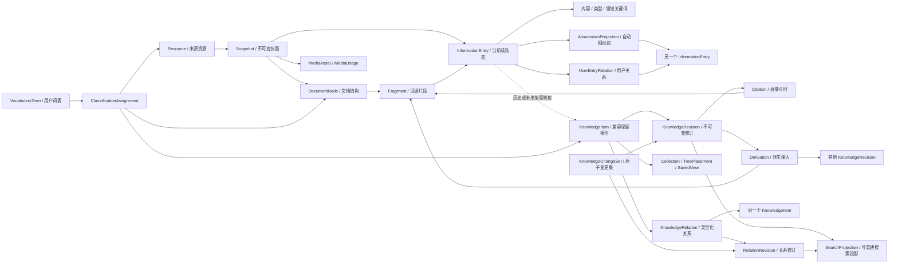

# StruInfo 知识核心架构

- 状态：M1F-1 可解释本地词法查询已实现；审核延期，继续无数据开发
- 最近更新：2026-08-24
- 相关决策：[ADR 0005](adr/0005-versioned-knowledge-core-and-ai-optional-operations.md)、[ADR 0006](adr/0006-external-configuration-and-personal-data-isolation.md)、[ADR 0007](adr/0007-information-entry-first-document-processing.md)、[ADR 0008](adr/0008-current-entry-state-and-portable-personal-data.md)、[ADR 0009](adr/0009-retire-superseded-m1c-runtime.md)、[ADR 0010](adr/0010-entry-centered-formal-knowledge-graph.md)、[ADR 0011](adr/0011-association-derived-formal-graph-edges.md)、[ADR 0012](adr/0012-provider-neutral-processing-runs-and-proposals.md)、[ADR 0013](adr/0013-openai-entry-tag-proposals.md)、[ADR 0014](adr/0014-openai-entry-association-proposals.md)、[ADR 0015](adr/0015-openai-entry-split-proposals.md)、[ADR 0016](adr/0016-manual-entry-fragment-grouping.md)、[ADR 0017](adr/0017-manual-within-fragment-entry-boundaries.md)、[ADR 0018](adr/0018-local-text-file-import.md)、[ADR 0019](adr/0019-local-html-pdf-import.md)、[ADR 0020](adr/0020-explainable-lexical-entry-search.md)
- 当前实现与未完成项：[当前项目状态与实现清单](current-project-state.md)

## 1. 核心结论

当前 StruInfo 是一个 Entry-first 的本机单用户工作台，不是只有向量和聊天接口的 RAG 容器。
活动运行时在 PostgreSQL 中保存来源证据和当前 `InformationEntry`，在外部数据根保存原始
Blob、个人偏好和导出。普通文档的主线是导入 → 拆分 → 标签 → 联系 → 查询。

`Fragment` 是不可变证据锚点，`InformationEntry` 是普通浏览、标注、联系、查询以及
M1E-2 正式图谱的节点。当前 Entry 采用一个成品态和并发版本，不保存每次中间编辑副本。
现有 Curation 和旧 `KnowledgeItem`/`KnowledgeRelation` 表及历史行只为既有数据和个人
数据包兼容保留；ADR 0009 已经删除它们的活动命令、repository adapter、HTTP 和 Web 入口。

当前无 AI 路径已实现：来源/快照/结构证据、确定性 Entry 物化、既有 Fragment 与 Fragment 内 Unicode 标量边界的人工分组、三维标签与两项评分、文档标签、可解释联系、精确/包含/近似词法组合查询、精确来源回看、完整个人数据包和 M1E-2 正式图谱。ADR 0012 建立不依赖 Provider 的 ProcessingRun/提案信封、读取/取消和真实总览轨道；ADR 0013、0014、0015 分别为用户明确选择的公开 Entry、公开 Entry 对和公开 Snapshot 增加可选 OpenAI tags、association 与 split 提案；三者都必须人工接受并复用现有写边界。尚未实现知识树/集合、复杂事实核验、AI 查询综合、语义向量/RAG、在线抓取或报告。

## 2. 当前数据类别与目标派生物

| 类别        | 主要内容                                                                                                   | 当前状态                              |
| ----------- | ---------------------------------------------------------------------------------------------------------- | ------------------------------------- |
| 证据        | Resource、不可变 Snapshot、Blob、DocumentNode、Fragment 和媒体引用                                         | 活动规范数据                          |
| 信息条目    | InformationEntry 当前成品态、三维标签、两项评分和 Fragment 输入                                            | 活动规范数据                          |
| 文档标签    | Snapshot 级当前标签及全文/Entry 覆盖证据                                                                   | 活动规范数据                          |
| Entry 联系  | 可重建相似度投影和当前人工 override                                                                        | 投影活动；人工控制是规范数据          |
| 用户偏好    | 快捷标签、提取开关、排除词、URL 规则、确认别名和版本化联系策略                                             | 活动；包体外文件                      |
| 正式知识    | Entry 节点、自动相似边、用户关系和精确来源；历史 Knowledge 表                                              | M1E-2 活动；旧表兼容保留              |
| 处理任务    | 当前 ProcessingRun、三类提案信封、精确 Fragment 输入和 typed split/tags/association payload                | 活动；三类提案均可启动、接受或拒绝    |
| 高级控制    | IntakeDecision、ConflictCase、集合、树、SavedView、自动策略                                                | 历史兼容或未实现                      |
| AI/检索派生 | OpenAI split、tags 与 selected-pair association；本地词法近似匹配；其他 Provider/提案、Embedding、语义综合 | 三个窄提案和 M1F-1 已实现；其余未实现 |

证据、Entry、正式知识和用户控制数据不能互相覆盖。删除联系投影不会删除 Entry；修改标签不会
改写 Snapshot；模型建议一个关系不能立即使其成为正式知识关系；只有人工接受后才调用现有图谱命令。

## 3. 规范对象关系

下图同时画出当前 Entry 主线、已实现的组合知识图谱，以及兼容保留的旧深度知识模型。`Resource → Snapshot → Fragment → Entry`、Entry 关键词/联系与有界正式图谱都是当前活动路径。



逻辑层次不要求拆成多个 PostgreSQL 服务或图数据库。第一版继续使用一个 PostgreSQL 数据库和一个应用 schema，由模块仓储拥有各自表；跨模块修改只能通过应用用例完成。

### 3.1 Fragment、Entry 与 Knowledge 的边界

Fragment、Entry、自动联系和用户关系不是同一对象的不同名称：

| 对象                    | 回答的问题                                     | 变更规则                                     |
| ----------------------- | ---------------------------------------------- | -------------------------------------------- |
| `Fragment`              | 原始 Snapshot 的哪个精确位置提供了证据？       | 随 Snapshot 不可变                           |
| `InformationEntry`      | 用户要浏览、标注、连接和找回的文档单元是什么？ | 稳定身份加当前成品态；可拆分、合并并保留沿袭 |
| `AssociationProjection` | 哪些 Entry 计算上相似并可直接成为图谱边？      | 可重建分数；人工编辑/block 优先              |
| 用户 Entry 关系         | 用户要怎样命名、定向或补充两个 Entry 的联系？  | 显式命令、当前状态、并发版本和删除/恢复      |

一个 Entry 可以引用一个或多个 Fragment；一个 Fragment 也可以参与多个当前 Entry。
普通编辑只覆盖 Entry 的当前成品态并推进乐观版本令牌，不再保存每次中间输入。正式图谱直接
引用 Entry 稳定身份，因此节点天然保留当前内容、标签、隐私与精确来源，不复制正文。

Entry 的内容、类型和领域关键词服务于文档组织和相似发现。由此产生的 AssociationProjection
可以直接作为 `similarity` 图谱边，但它只陈述“计算上相似”，不能冒充经过人工核验的事实关系。
重建可以更新自动边的分数和解释，不能覆盖用户编辑或持久 block；历史 `KnowledgeItem`/Revision
仍可作为兼容或未来深层语义对象，但不是 M1E-2 页面默认节点。

## 4. 必须分开的六个维度

阶段 0 的人工审核暴露了一个建模错误：内容类型曾被填入处理动作字段。具体人工值已移至仓库外的用户文档；规范模型只记录由此确认的通用规则——内容分类不是处理动作。系统必须分别保存以下维度。

| 维度                    | 示例                                                               | 所有者与用途                         |
| ----------------------- | ------------------------------------------------------------------ | ------------------------------------ |
| `ContentClassification` | 小说、论文、教程、广告、工具介绍、周刊条目                         | 用户工作区词表；回答“它属于什么”     |
| `IntakeAction`          | 完整处理、拆分、压缩、仅保留来源、忽略、待审核                     | 系统工作流动作；回答“现在如何处理”   |
| `KnowledgeKind`         | 新写入：概念、观点、事件、方法、资源、其他；兼容旧实体、框架、作品 | 知识结构类型；回答“形成什么知识”     |
| `EpistemicRole`         | 来源原文所述、从来源整理、根据来源推断、用户补充判断               | 形成方式；回答“这条内容是怎样形成的” |
| `ReviewState`           | 草稿、待审核、已确认、有争议、被驳回、已撤回                       | 生命周期；回答“当前是否被接受”       |
| `OperationOrigin`       | 用户手工、确定性解析、声明式规则、确定性导入、AI 提案、外部客户端  | 审计来源；回答“这次变化由什么产生”   |

当前普通文档工作流只在“标签”页维护有用/有趣评分、确定性内容关键词、类型/领域标签和个人别名；旧 IntakeAction、判断原因与手工联系入口已从活动 UI 和偏好协议删除。既有 Curation 行只作为历史兼容数据保留，不再驱动导入 → 拆分 → 标签 → 联系 → 查询主线。正式 Knowledge 的 KnowledgeKind、EpistemicRole 和 ReviewState 继续属于尚待重新定义 UI 的正式知识协议，不得反向混入普通标签审核。

当前普通标签审核不再复用 Curation 的处理动作。`有用程度` 与 `有趣程度` 直接保存为
当前 `InformationEntry` 的 `usefulness_score` 与 `interest_score`；它们是用户对当前成品条目的
两项独立评价，不隐式生成拆分、压缩、准入或正式知识写入命令。

用户自定义快捷标签保存在数据根 `preferences/` 下按工作区隔离的个人配置中。快捷标签只有在
用户点选并保存 Entry 时才进入当前内容关键词；新增或删除快捷按钮不会重写既有 Entry。无 AI 的
确定性提取只产生可编辑候选：链接目标、路径和文件名默认剥离，链接标题仍可表达语义；用户
可以关闭提取、显式允许 URL 域名或维护精确排除词。提交前按大小写无关身份去重，再应用
用户明确保存的别名映射；系统不会凭字符串包含关系擅自合并不同概念。

000011 在收敛 Entry 当前态时承担一次兼容桥接：与当前 Entry Fragment 输入对应的旧 Curation
`information_density` 和 `current_interest` 评分按 0–4 到 1–5 映射；当前 active 且 assigned 的
分类词投影为内容关键词。若 Entry 已有当前评分或同一规范关键词则保留现值并跳过重复。桥接完成后，
旧 Curation 表仅作为历史数据和个人数据包兼容内容，不再有活动命令、读取端口或普通审核写入。

普通 Entry、自动相似边和用户关系保持显式来源。M1E-2 已按 ADR 0011 接通正式知识图谱读取和编辑；标签审核仍不会创建用户语义关系，也不会恢复旧处理意图、判断原因或手工联系。ADR 0009
已删除 M1C Curation、Knowledge 和 Retrieval 的活动纯逻辑、repository adapter、HTTP 与 Web
入口；既有迁移、历史表、旧行和个人数据包分区继续保留，代码清理不等于用户数据删除。

`EpistemicRole`、`KnowledgeItem`、`KnowledgeRevision` 和旧类型化关系仍是历史与可选深层
语义模型的词汇，但不再是 M1E-2 图谱页面的默认编辑对象。新页面通过现有 Association 投影与新的最小用户编辑边界维护 Entry 间图谱；不得悄悄恢复
已删除的高级编辑器。

## 5. 历史与可选深层 Knowledge 模型（当前运行时未启用）

### 5.1 稳定身份与不可变修订

本节记录兼容保留及远期深层语义模型，不是当前 API 清单，也不是 M1E-2 首个切片。`KnowledgeItem` 只承担稳定身份、工作区边界和当前修订指针。标题、正文、类型、时间和状态等可变化语义进入 `KnowledgeRevision`.

每次有效编辑创建新修订：

- 旧修订不原地覆盖；
- 当前修订指针与变更集在同一事务更新；
- 引用绑定具体修订，语义变化后必须重新核验；
- 撤回使用补偿修订和 `supersedes`/`reverted_by` 关系；
- 隐私删除与知识撤回是两种不同操作，前者按保留策略撤销访问并最终清理字节。

隐私文档使用规范数据中的显式、可查询事实，而不是前端临时标签。`Resource.is_private`
标记整个来源文档；`KnowledgeRevision.is_private` 与
`RelationRevision.is_private` 固化该修订的隐私传播结果。首版传播是单调的：来自隐私
Fragment、隐私历史修订或既有隐私修订的知识保持隐私；关系使用隐私证据或任一当前端点
为隐私时也保持隐私。解除隐私必须是未来独立、可审计的显式命令，普通编辑不能顺带完成。

### 5.2 类型与可扩展字段

核心表保存稳定且经常查询的字段，例如工作区、类型、状态、语言、时间范围、当前修订、归属者和版本。低频且随知识类型变化的字段可以进入带 schema 版本的受验证 `jsonb` payload，但不能把整个数据库退化为无约束 EAV 或任意 JSON 文档库。

用户分类、主题、领域和自定义标签通过 `VocabularyTerm` 与 `ClassificationAssignment` 建模。词表记录稳定 key、显示名、父词条、版本、适用对象和退役状态；重命名显示名不改变历史引用。首个证据目标实现由 [`C-SLICE-A-CURATION-r3`](manual-curation-contract.md) 冻结并归 `curation` 模块所有；未来对正式 `KnowledgeItem` 的分类只复用其词表读取边界，由知识核心命令拥有指派，不能让两个模块共同写同一行。

### 5.3 别名、同一性与合并

`KnowledgeAlias` 保存名称、语言、规范化形式和适用范围。名称相同只产生同一性候选，不自动合并。

在正式 `KnowledgeAlias` 投影实现前，M1C 使用包体外工作区偏好保存轻量词表整理规则：
大小写身份直接复用现有词条；中英文等价写法由用户确认为别名；包含或语义相近的词只作为
候选，由用户选择翻译提示、相关提示或合并。显式合并会把当前分类迁移到保留词条并退役
来源词条，历史修订不删除。该偏好还可把任一用户词条映射到通用 `KnowledgeKind`，例如
`work`；真实标签名称不进入源码。词表提示不是正式 `KnowledgeRelation`，后续投影可以从
这些外部规则和已确认领域事实重建。

合并两个知识项属于高影响命令：

- 选择保留的稳定 ID；
- 保留被合并 ID 的重定向和历史；
- 显式迁移或保留关系、分类和树位置；
- 生成可审核的变更集；
- 不删除旧证据或修订。

### 5.4 关系

`KnowledgeRelation` 只保存稳定关系身份、工作区和当前修订指针；`RelationRevision` 保存某次关系陈述的主体、关系类型、客体、方向、限定条件、认知角色、审核状态、有效时间和依据。改变任一端点或谓词通常创建新关系；只有在纠错并保留同一业务身份确有价值时才修订原关系。

关系必须：

- 有方向和明确类型；
- 可以有多个相互独立或冲突的来源；
- 可以被修订、撤回或标记有争议；
- 支持条件、范围和时间，而不是把所有关系压成永久事实；
- 与 `TreePlacement` 分离；树的父子关系不会自动创建 `is_a` 或 `part_of`。

关系类型可以由版本化词表扩展，但具有权限或算法语义的系统关系必须由迁移和代码审查引入，不能通过个人配置改变安全行为。

### 5.5 引用与派生

`Citation` 表示某个知识或关系修订直接依赖哪个 `Fragment`。`Derivation` 表示总结、推断、组合或规则结果由哪些片段、修订、处理运行或规则版本产生。

直接引用与派生不可互换：AI 总结可以由多个来源派生，但不能因此声称每个句子都是某一来源原话。

### 5.6 组合与重组

重组知识不应复制原正文：

- `Collection` 保存有序或无序的知识引用；
- `TreePlacement` 把同一知识放到多个导航位置；
- `SavedView` 保存查询条件、排序和展示配置；
- `Framework` 类型的知识修订可以通过成员关系组合多个概念、方法和断言；
- 新的综合文章或说明是一个新修订，并通过 `Derivation` 指向所使用的知识和证据。

因此，“拆分”产生较小的正式单元，“连接”产生类型化关系，“重组”产生引用既有单元的集合、框架或派生修订；三者都不会破坏原始来源。

### 5.7 关系表族

第一版按模块组织普通关系表，而不是建立一个万能节点表：

| 表族                 | 代表对象                                                                            | 关键约束                                                      |
| -------------------- | ----------------------------------------------------------------------------------- | ------------------------------------------------------------- |
| `evidence`           | Resource、Snapshot、DocumentNode、Fragment、MediaAsset/Usage                        | Snapshot 和证据定位不可变；Blob 以内容哈希校验                |
| `vocabulary`         | VocabularyTerm、VocabularyRevision、ClassificationAssignment                        | 词条 key 稳定；显示名和层级可版本化；赋值保留历史             |
| `knowledge identity` | KnowledgeItem、KnowledgeAlias、KnowledgeRelation                                    | 稳定 ID、工作区范围、当前修订指针和合并重定向                 |
| `knowledge history`  | KnowledgeRevision、RelationRevision                                                 | 追加式修订；当前指针由同一事务推进                            |
| `provenance`         | RevisionCitation、RelationCitation、DerivationInput                                 | 使用真实外键指向精确修订和 Fragment，不用无法约束的多态字符串 |
| `change control`     | KnowledgeChangeSet、ChangeOperation、Candidate、ConflictCase                        | 幂等键、预期版本、授权依据、来源和审计一起提交                |
| `composition`        | Collection、CollectionMember、TreePlacement、SavedView                              | 只引用稳定知识 ID；删除视图不删除知识或证据                   |
| `retrieval`          | SearchProjection、TermPosting、RelationNeighborhoodProjection、可选 EmbeddingRecord | 记录输入修订和算法/模型版本，可整体删除重建                   |

所有业务主键都和 `workspace_id` 一起进入唯一约束、外键解析和查询条件。跨表“任意对象”引用优先拆成带真实外键的专用连接表；只有公共协议明确需要并能在应用层完整验证时，才使用带对象类型的通用引用。

## 6. 图谱编辑使用一个明确命令边界

可见 AssociationProjection 通过读取边界直接成为自动 `similarity` 图谱边，不需要写入命令或
逐条确认。任何用户改变仍必须使用窄命令，而不是让页面直接修改表。第一版只需要：

- 编辑自动边的标签或方向，形成优先于投影展示的用户解释；
- 屏蔽/删除或恢复自动边；
- 在两个现有 Entry 之间创建、修改或删除用户关系；
- 读取一个中心 Entry 的有界组合邻域。

每个写命令都需要工作区、两个 Entry 端点、预期版本、操作来源和幂等身份；纯用户关系还需要
稳定关系身份。知识模块核验端点、隐私、方向和并发版本后原子提交。自动边继续使用现有投影和
override，不复制为第二套相似度表；重建只更新底层分数与解释，不能覆盖用户编辑或 block。

创建 KnowledgeItem/Revision、别名、集合、树、ConflictCase 或完整 KnowledgeChangeSet 属于历史
兼容或未来深层语义能力，不是 M1E-2 首个切片。未来重新引入时仍必须经过新的公开命令和单独验收。

调用者可以是：

1. 网页中的用户手工操作；
2. Markdown、CSV、JSON 等确定性导入器；
3. 用户启用的声明式规则；
4. AI/OCR 适配器生成的提案；Embedding 适配器只构建检索投影；
5. 将来经授权的外部项目。

来源不同不会产生第二套数据库写入逻辑。AI 没有特殊的“直接入库通道”。

## 7. 完全不依赖 AI 的操作模式

| 能力     | 当前无 AI 行为                                                                             | 尚未实现的增强                                      |
| -------- | ------------------------------------------------------------------------------------------ | --------------------------------------------------- |
| 摄取     | 手工 Markdown、固定 Git Markdown、单份本地 UTF-8 Markdown/文本文件、完整证据与隐私标记     | HTML/PDF/Office/OCR、多文件、网页/RSS/API、定时采集 |
| 拆分     | CommonMark/周刊 profile；既有 Fragment/标量边界人工分组；可选公开 Snapshot OpenAI 提案     | 重排、结构迁移、可替换规则、私密外发                |
| 标签     | 三维标签、五档有用/有趣、确定性候选、外部快捷标签/排除/别名；可选 OpenAI tags              | 自动语义合并和无确认接受                            |
| 联系     | 确定性相似边、分项解释、增强/削弱/屏蔽/恢复、用户图谱关系                                  | 复杂事实关系类型                                    |
| 查询     | 标题/正文/标签的精确、包含和近似词法匹配；结构、来源、时间、隐私、一至两跳联系、游标和来源 | 中文分词、语义/向量/RAG、在线混合查询               |
| 传输     | 56 表、引用 Blob 字节、偏好、Entry v3、Association v3 与 Processing v4；空目标恢复         | 跨工作区克隆、非空合并、灾难恢复                    |
| 正式知识 | 最高匹配 Entry 中心、有界图谱/列表、边来源、用户编辑、AI 联系提案和精确来源                | 树/集合/时间线与复杂本体                            |

没有配置 AI Provider 时，系统显示“AI 未启用”，导入、确定性/人工拆分、标签、联系和查询仍可使用。完整配置 OpenAI 后分别发布 `ai_split`、`ai_tags` 与 `ai_associations`。
`processing_runs` 只证明持久任务读取/取消和提案信封可用；三个 `ai_*` capability 只证明各自窄提案可用，不能被解释为 AI 查询或自动维护已经启用。

工作区 Bundle v1 通过五个闭合分区携带当前数据库状态、Blob 字节和偏好。它不是任意 JSON
知识存储，也不携带运行配置或秘密。

## 8. 搜索组织

当前活动搜索以 InformationEntry 为主结果单元，并为完整隐私文档保留独立结果通道：

1. 对查询文本执行确定性规范化，并按显式 `exact`、`substring` 或 `fuzzy` 模式匹配；
2. 在用户选择的标题、正文和标签范围内匹配；标签覆盖内容、类型和领域关键词；近似模式返回有界词法分，不代表语义相同；
3. 支持内容关键词、来源、Snapshot、类型/自定义类型、领域/自定义领域、主副领域、整篇/拆分和发布时间/采集时间过滤；
4. 可从一个 Entry 沿未屏蔽联系遍历一或两跳，并返回分数和路径；
5. 隐私范围在计数、候选、遍历、排序和分页之前应用；
6. Entry 结果使用绑定查询语义的游标，返回匹配原因、过滤原因和精确 Fragment 来源；
7. 只有当次显式包含隐私时，服务端才从外部 Blob 按需匹配完整私密正文，并在 Entry 分页之外返回独立文档结果。

当前没有 `pg_trgm`、中文词项索引、SQL query pushdown、Embedding、语义问答或在线搜索。M1F-1 的近似模式是内存中的可解释词法窗口评分，不是语义检索。
345 Entry 的既有实测没有证明需要这些复杂度。完整隐私文档只在显式隐私范围下进入独立结果
通道，正文不复制到数据库或普通 Entry 索引。

M1E-2 知识页复用确定性 Entry 匹配选择最高结果为中心，再读取有界正式邻域；它不替代本节的
完整 Query 结果。别名、词项投影、向量召回和 RAG 综合只有在对应产品边界接受并有真实使用
证据后加入；所有派生索引必须可从规范数据重建。

## 9. 数据库特性与不变量

第一版继续使用 PostgreSQL 18、普通关系表和邻接关系，不增加图数据库、向量数据库或独立搜索服务。

### 9.1 当前活动不变量

- 每条个人业务记录显式携带 `workspace_id`，并进入查询、唯一约束和幂等范围；
- Resource/Snapshot/Fragment 是证据身份，Snapshot 及其结构不可原地改写；
- 当前 Entry、Document 标签和联系控制使用期望版本，迟到写入不能覆盖新状态；
- Entry 联系投影可以重建；版本化内容/类型/领域权重与阈值保存在外部个人配置，策略重建不能静默覆盖人工增强/削弱/屏蔽/恢复；
- 导入和写入保持参数化 SQL、工作区隔离、事务和明确失败；
- Blob 使用内容寻址，个人数据包同时携带数据库状态、引用字节和偏好；
- 隐私先于读取计数、联系候选、遍历、排序和分页，披露需要当前操作显式选择；
- ProcessingRun 使用闭合状态转换和期望版本；错误只保存稳定 code，提案只引用同工作区 typed targets 与精确 Fragment；
- 所有 AI 字段和服务都可以缺席，当前无 AI 主线仍完整运行。

### 9.2 M1E-2 图谱边不变量

- 所有边只引用同一工作区中的两个现有 Entry 稳定身份；
- 可见 AssociationProjection 无需人工确认即可成为对称 `similarity` 边；
- 每条边必须标明自动计算、用户编辑或用户创建来源；自动边还显示分数和解释；
- 用户编辑、屏蔽/删除和恢复必须经过明确命令，并优先于后续投影重建；
- 用户创建关系的标签、方向、当前状态和并发版本是规范工作区数据；
- 隐私在中心搜索和关系遍历前应用，隐藏端点的边也隐藏；
- 节点来源沿 Entry 的精确 Fragment 输入返回，不复制或猜测 provenance；
- 历史 Knowledge 表不会自动迁移成 Entry 图谱，也不授权恢复旧 Knowledge API。

## 10. 工程代码、运行配置和个人数据隔离

```text
应用安装/镜像
  ├─ 程序代码、迁移、契约、配置 schema、无真实值示例
  └─ 不含个人知识、偏好、词表、规则、凭据、快照、导出或备份

外部运行配置
  └─ 数据库地址、监听地址、外部数据根、工作区身份和秘密引用

PostgreSQL 当前工作区状态
  ├─ Resource / Snapshot / DocumentNode / Fragment
  ├─ InformationEntry / Document 标签 / Entry 联系
  └─ 只为兼容保留的历史 Curation / Knowledge 行

外部 Blob/Data Root
  ├─ 原始/规范化 Blob、图片和附件
  ├─ preferences/ 下的个人偏好
  └─ exports/ 与备份；不位于源码仓库或安装目录

外部秘密存储
  └─ 数据库及未来 AI/Webhook 凭据；业务记录只保存允许的引用
```

个人分类词、Entry/正式知识正文、偏好评分、探索策略、信源订阅、保存查询、UI 布局和用户提示词都属于用户资源。它们不得作为 TypeScript 常量、真实 fixture、迁移 seed、前端 mock、构建资源或容器镜像内容出现。当前偏好是外部文件；未来新增数据也必须先选择明确的外部文件或数据库边界。

代码可以固定数据库协议、状态机、权限规则、字段校验和合成测试数据。仓库可以保存没有真实值的配置 schema 与示例，但实际运行配置、个人配置和数据必须从包体外加载。

应用模块只依赖稳定协议和可替换端口，不直接依赖个人文件：

```text
同一应用构建
  └─ composition / typed ports
       ├─ 包体外运行配置与秘密引用 ──> PostgreSQL / Blob adapters
       ├─ 稳定 workspace_id ─────────> 工作区范围的 repository
       └─ 版本化个人数据包 ──────────> 校验后的导入 / 导出命令
```

更换个人资料集的正式方式是切换稳定工作区，或把外部个人数据包验证并恢复到空工作区，而不是替换源码目录中的“记忆模块”。首版可以通过受控重启或关闭并重新打开 composition root 完成切换；失败不能留下数据库来自 A、Blob 根来自 B 的混合状态。个人数据包是可移植载体，不是直接在线存储或可执行插件。

证据 Resource 的 `source_key` 是 adapter-owned、deterministic、portable opaque identity。
盘符路径、UNC/rooted path、POSIX 绝对路径、Windows 反斜杠形式或 traversal segment 不得成为持久身份。
本地文件适配器应使用上传登记 ID、适配器记录 ID、内容身份或其他可移植 key。
若未来必须保留原始本地路径，应定义独立的私有 typed locator 及导出和日志脱敏规则，不能把路径重载到 `source_key`。

Windows 本地运行和 Linux 部署都必须使用源码/安装目录之外的数据根。启动时规范化真实路径并拒绝把个人数据根、Blob 根、导出或备份目录放在仓库、应用安装目录或只读包体内部。容器部署使用外部卷或对象存储，不能把数据写入镜像层。

候选应用包通过[制品边界](application-artifact-boundary.md)实际枚举并生成哈希清单；被 Git 忽略不代表可以进入包体。容器镜像仍在独立准入门中验证，当前结果不能被描述为镜像或发布许可已经完成。

## 11. 当前实现清单与下一顺序

### 11.1 当前活动实现

1. **运行与隔离**：包体外配置固定工作区、PostgreSQL、Blob 根、偏好和导出目录；
2. **导入**：手工 Markdown、固定 Git Markdown 或单份本地 UTF-8 Markdown/文本文件原子写入证据元数据、内容寻址 Blob 和结构；
3. **拆分**：用户选择 Snapshot，以 CommonMark section、人工 Fragment/标量区间分组或已接受 AI 提案幂等物化 Entry；
4. **标签**：保存 Entry 当前正文、三维标签、两项评分和外部个人词汇偏好；
5. **文档标签**：按全文出现与 Entry 覆盖确定性聚合，或由用户保存当前标签；
6. **联系**：重建分项可解释的候选投影，并保存逐对人工控制；
7. **查询**：组合文本、结构、来源、时间、隐私和一至两跳联系，稳定分页并返回精确证据；
8. **传输**：五分区个人数据包携带 56 张当前工作区表、引用 Blob 字节、含联系策略的偏好、Entry v3 精确区间、Association v3 图谱元数据和 Processing v4 状态；
9. **处理任务**：Provider-neutral ProcessingRun/提案信封持久化，API 读取/取消；可选 OpenAI split、tags 与 selected-pair association 启动、接受/拒绝；总览真实轨道；
10. **产品壳**：总览、导入、拆分、标签、联系、查询、正式知识七个活动页面；
11. **必要基础**：迁移、健康检查、日志、生命周期、共享队列基础、测试、构建与制品审计。

### 11.2 兼容保留

- `000003`、`000004`、`000006`、`000007` 等历史迁移及其数据表；
- 旧个人数据包分区和历史行；
- 窄迁移/兼容测试与不参与当前质量门的 PostgreSQL TM2 档案；
- `m1c_*` 命名残留，只承载当前本地接口或兼容传输，不代表旧工作流仍活动。

### 11.3 下一实施顺序

M1E-2 与直接使用增量已经完成。ADR 0012 的 M1E-3A 已接通中性任务边界；ADR 0013/0014/0015 的 M1E-3B/C/D 已选择同一 OpenAI Responses API，分别实现公开 Entry 标签、selected-pair 联系和公开 Snapshot 拆分提案，并把接受转换为既有 Entry revision、graph edge command 或 Entry materialization。ADR 0016 的 M1E-4A 补齐既有 Fragment 边界上的本地人工分组，ADR 0017 的 M1E-4B 进一步允许 Fragment 内 Unicode 标量边界，并让确定性、人工和 AI 接受共用唯一空 Snapshot 原子边界。ADR 0018/0019 的 M1E-5A/5B 把单份本地 Markdown、文本、HTML 和 PDF 接入同一 Evidence 与 Split 主线；ADR 0020 的 M1F-1 补齐精确、包含和近似本地词法查询。全部审核流程已延期，活动工作区保持无数据；下一增量来自直接使用或另行接受的窄产品边界。没有新决策前不扩展第二 Provider、自动接受、私密外发、查询综合、RAG、向量或自动采集。实际使用暴露的五步主线、图谱或隐私 `PRODUCT_BLOCKER` 仍优先。

## 12. 当前验收与未来验收

### 12.1 当前可运行基线

当前验收只覆盖实际存在的 Entry-first 产品边界：

- 文档 Entry 可以在不创建 KnowledgeItem 的情况下设置三类关键词、五档评价、建立可解释联系并被搜索；
- 导入、确定性/人工拆分、标签、联系和查询只调用当前 Evidence、Entry、Document 标签与 Entry 联系边界，不依赖已退役的 Curation/Knowledge 运行时；
- Entry 与 Fragment 保持不同身份，并能从查询结果精确返回来源证据；
- 正式知识页通过独立图谱读写边界组合现有联系和用户关系，不恢复旧 Knowledge API，也不把“联系”页的候选调参冒充成正式图谱编辑；
- 没有 AI 配置时，当前五步主线、个人数据导入导出和恢复仍可使用；
- 个人资料、偏好、原始 Blob、导出和备份保持在仓库与应用包体之外。

### 12.2 M1E-2 正式知识边界

ADR 0010/0011 接受的页面对象、检索语义和边来源已由 M1E-2 实现并纳入聚焦验收：

- 搜索最高匹配 Entry 并将其作为图谱中心，同时允许改选中心；
- 自动相似联系无需晋升即可作为带来源、分数和解释的 `similarity` 边显示；
- 用户可编辑、屏蔽/删除、恢复自动边，也可创建和删除纯用户关系；
- 只读取有界邻域，并能显式换中心或逐步展开；
- Association 重建可更新自动分数，但不得覆盖用户编辑或 block；
- 图谱和等价列表/树返回相同核心节点与边，并能打开精确 Fragment 来源；
- 公开、包含隐私和只看隐私范围在中心搜索与遍历前生效；
- 个人数据包往返用户关系、编辑和 block，投影本身仍可重建。

这些能力以当前图谱纯逻辑、迁移、repository、HTTP service、客户端、Bundle 和 Web 验证为依据；保留的历史 Knowledge 表仍不能单独证明任何活动能力。

### 12.3 M1E-3A 任务与提案边界

- ProcessingRun 稳定身份、来源、阶段、进度、隐私范围、状态、错误 code 和版本持久化；
- queued/running 任务可用可见版本取消，终态不可重开；
- split/tags/association 提案信封只保存 typed targets、摘要和精确 Fragment 输入；
- 总览仅展示真实记录；无记录和无 Provider 是正常空状态；
- 个人数据包往返三张 Processing 表，旧包缺失该分区时恢复为空；
- M1E-3A 自身没有公开启动、Provider 调用、闭合提案 payload 或接受入口；模型始终不能直接写 Entry/图谱。

### 12.4 M1E-3B OpenAI tags 边界

- OpenAI Responses API 适配器只接收一个公开 Entry 的标题路径与正文，并要求闭合 JSON Schema 输出；
- 私密 Entry 在 Provider 调用前拒绝，Blob、API key、其他 Entry、偏好和数据库连接不会进入请求；
- API/标签页提供按 Entry 列表、显式启动、接受和拒绝，通用 `ai` capability 不会被开启；
- 接受通过 `prepareAiEntryTagRevision` 和现有 `reviseEntry`，保留正文、评分、隐私、Fragment 输入与乐观并发；
- Processing Bundle v2 携带三张 typed proposal 表，旧 v1 升级为空状态；
- 没有 Provider 配置时 `ai_tags` 缺席，完整无 AI 主线和启动不受影响。

### 12.5 M1E-3C OpenAI association 边界

- 只有用户明确选中的两个公开 Entry 会进入 Provider 请求；
- 任一隐私端点在 fetch 前拒绝，其他 Entry、Blob、偏好和数据库连接不进入请求；
- typed payload 冻结两个 Entry 修订、override 修订、模型、Prompt 版本、关系名和方向；
- API/正式知识页提供列表、显式启动、接受和拒绝，并显示 `AI 生成 · 待审核`；
- 接受复用现有 graph edge command/CAS，图谱结果标记 `ai_assisted`，后续人工编辑仍是最终权威；
- Processing Bundle v3 携带第七张 Processing 表，旧 v1/v2 升级为空状态；
- 无 Provider 配置时 `ai_associations` 缺席，人工图谱、确定性联系与所有无 AI 主线不受影响。

### 12.6 M1E-3D OpenAI split 边界

- 只有用户明确选择的公开 Snapshot 会进入 split 提案链；私密 Snapshot 在 Blob 读取与 fetch 前拒绝；
- Provider 只接收结构顺序、ordinal 和 section Fragment 正文，不接收 workspace/Snapshot/Fragment ID、偏好或数据库信息；
- closed payload 必须以连续、不重叠、完整覆盖的 Fragment 分组表示，不允许模型改写原文；
- API/拆分页提供列表、显式启动、逐组精确 Fragment 审阅、接受和拒绝，并清楚标明外部 AI 来源；
- 接受从本地 Fragment 重建 Entry 标题与正文，复用 workspace lock 和既有空 Snapshot 物化边界；拒绝不创建 Entry；
- Processing Bundle v4 携带三张 split payload 表，旧 v1/v2/v3 升级为空状态；
- 无 Provider 配置时 `ai_split` 缺席，确定性 section 物化和其余无 AI 主线不受影响。

### 12.7 M1E-4A 人工 Fragment 分组边界

- 只处理用户当前选择且尚无 Entry 的 Snapshot；隐私 Snapshot 需要当次显式本地范围；
- 初始一 Fragment 一组，用户可以合并相邻组、在任一既有 Fragment 前重新拆开、重置、全部合并并编辑标题；
- 扁平分组必须按来源顺序恰好覆盖第一结构的全部 section Fragment，不能遗漏、重复、重排或提交正文；
- 服务端从本地 Fragment 重建正文并记录 `struinfo.entry-split.manual-group.v1`，Snapshot/Fragment 证据保持不可变；
- 确定性、人工和 AI 接受共享 workspace lock 下的空 Snapshot 原子赢家，后到路径不会叠加或覆盖；
- M1E-4A 本身不新增迁移、依赖、Bundle 分区或个人配置；当时尚未覆盖的 Fragment 内范围由 ADR 0017 后继实现。

### 12.8 M1E-4B Fragment 内人工边界

- 人工输入以不可变 Fragment 正文的半开 Unicode 标量区间表示，完整覆盖全部 section Fragment；
- 区间必须连续、无缺口、无重叠且保持来源顺序；服务端只接收标题、Fragment ID 和区间并重建正文；
- 前向迁移 `000017` 的可选一对一子表保存精确范围；无范围行继续表示完整 Fragment；
- Entry Bundle v3 携带第八张范围表，v1/v2 升级为空范围状态，个人数据包覆盖 56 张当前表；
- Split 工作台只读显示每个来源片段，支持鼠标或键盘放置光标并显式执行“在光标处分开”；
- 继续复用空 Snapshot 原子赢家和显式隐私范围，不改证据、不引入 Provider/依赖，也不迁移已有 Entry 结构。

### 12.9 M1E-5A 本地文本文件导入边界

- 只读取用户当次明确选择或拖入的一份 `.md`、`.markdown`、`.txt`，不扫描目录，不发送机器路径；
- 浏览器与服务端共同保持 1 MiB、严格 UTF-8、非空/NUL 和 canonical Base64 边界；`uploaded_file` 与 Base64 必须同时出现；
- 无前置文字时原始字节保持不变；有前置文字时形成明确的组合 Snapshot，不能冒充原文件副本；
- 基础文件名与 SHA-256 构成默认 portable source key，用户可用显式别名替换；
- 导入继续复用现有外部 Blob、不可变 Snapshot/Fragment、隐私传播和幂等命令；成功后才进入现有 Split 队列；
- 本切片不新增迁移、依赖、仓库内用户文件或第二套存储，也不声称支持 PDF/DOCX/OCR、多文件或自动采集。

### 12.10 M1F-1 可解释本地词法查询边界

- 非空查询显式选择 `exact`、`substring` 或 `fuzzy`，以及标题、正文、标签中的至少一项；默认保持全部字段的 substring 行为；
- 全部模式复用既有双 NFC + ASCII 小写 search key；近似模式只比较查询长度附近的 Unicode 字符与双字符窗口，短查询不宽泛近似；
- 结果返回整数词法分，排序和 cursor v2 绑定模式、规范字段集合与分数；界面不得把它显示成概率、可靠性或语义等价；
- 隐私在匹配、评分、计数、关联遍历、排序和分页前生效；完整隐私文档只在当次明确授权后以相同字段语义读取外部 Blob；
- 本切片不新增迁移、依赖、索引、Provider、搜索服务或个人数据。中文分词、自动翻译、语义/向量检索、RAG 与 query pushdown 仍需独立证据和决策。

### 12.11 延期审核与环境门

所有者体验、真实 Provider 质量/费用、真实 PostgreSQL 正式 TM2、容器/Linux 等价性、公开网络部署、认证授权、生产资源限制、备份恢复演练和发布分发均保持延期或未签发。它们必须如实报告状态，但不能在没有当前产品阻断证据时拖停 Entry 主线开发；活动工作区仍禁止恢复真实资料。
