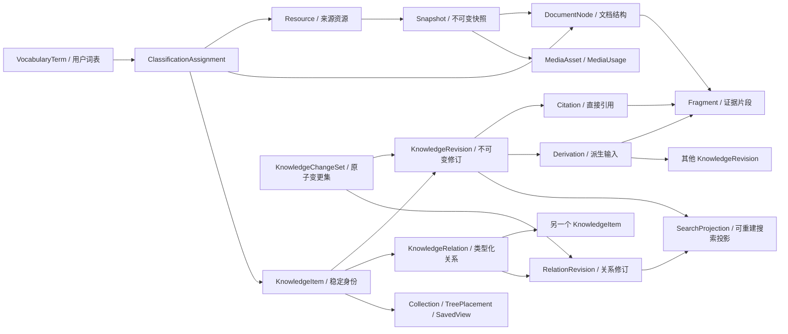

# StruInfo 知识核心架构

- 状态：知识模型、无 AI 操作路径、个人数据隔离与 A0 人工分类/准入合同均已冻结
- 最近更新：2026-08-12
- 相关决策：[ADR 0005](adr/0005-versioned-knowledge-core-and-ai-optional-operations.md)、[ADR 0006](adr/0006-external-configuration-and-personal-data-isolation.md)

## 1. 核心结论

StruInfo 的数据库不是“AI 生成内容的保存处”，也不是只有向量和聊天接口的 RAG 容器。它是一个建立在 PostgreSQL 上、由来源证据支撑、具有不可变修订和类型化关系的关系型知识图。

系统先保证以下能力在完全没有 AI 供应商、模型凭据、Embedding 或自然语言回答时仍然成立：

- 保存来源、快照、原文结构、图片位置和稳定证据；
- 由用户或确定性解析器分类、拆分、编辑和创建知识；
- 建立、修订、撤回和审核类型化关系；
- 把既有知识组合成框架、集合、树视图和时间线，而不复制正文；
- 按标题、正文、别名、类型、来源、时间、关系和状态检索；
- 查看历史、证据、派生、冲突、变更集和操作来源；
- 导入、导出、备份、恢复和在不依赖 AI 的情况下继续维护。

AI 可以显著降低拆分、摘要、实体识别、关系发现、冲突核验和查询综合的人工成本，但它只能生成与手工或规则处理相同格式的提案，不能成为数据库正确性或基本可用性的前提。

## 2. 四类数据与三类派生物

| 类别         | 主要内容                                                           | 是否为规范事实                                           |
| ------------ | ------------------------------------------------------------------ | -------------------------------------------------------- |
| 证据         | `Resource`、不可变 `Snapshot`、Blob、获取身份和内容哈希            | 是；表示系统实际保存或引用了什么                         |
| 文档结构     | `DocumentNode`、`Fragment`、`MediaAsset`、`MediaUsage` 和原始顺序  | 是；表示证据内部实际如何组织                             |
| 正式知识     | 稳定知识项、不可变修订、别名、关系、引用、派生和冲突               | 是；表示当前接受并保留历史的知识状态                     |
| 用户控制数据 | 分类词表、准入动作、审核、集合、树位置、保存查询、偏好、策略和布局 | 是；表示用户如何组织和控制自己的工作区，但不等于知识语义 |
| 搜索投影     | 规范化文本、词项倒排、`pg_trgm`、关系邻域、可选向量和排序字段      | 否；可以从规范数据重建                                   |
| 导航投影     | 由树位置解析出的树、图布局、时间线分组、列表和看板                 | 否；不是知识语义本身                                     |
| AI 产物      | 摘要、提案、候选关系、查询综合和规则建议                           | 否；授权提交后产生的正式修订才属于知识                   |

证据、文档、知识和控制数据不能互相覆盖。例如，删除一个树位置不会删除知识；修改分类不会改写来源；模型建议一个关系不会立即使关系成立。

## 3. 规范对象关系



逻辑层次不要求拆成多个 PostgreSQL 服务或图数据库。第一版继续使用一个 PostgreSQL 数据库和一个应用 schema，由模块仓储拥有各自表；跨模块修改只能通过应用用例完成。

## 4. 必须分开的六个维度

阶段 0 的人工审核暴露了一个建模错误：内容类型曾被填入处理动作字段。具体人工值已移至仓库外的用户文档；规范模型只记录由此确认的通用规则——内容分类不是处理动作。系统必须分别保存以下维度。

| 维度                    | 示例                                                              | 所有者与用途                             |
| ----------------------- | ----------------------------------------------------------------- | ---------------------------------------- |
| `ContentClassification` | 小说、论文、教程、广告、工具介绍、周刊条目                        | 用户工作区词表；回答“它属于什么”         |
| `IntakeAction`          | 完整处理、拆分、压缩、仅保留来源、忽略、待审核                    | 系统工作流动作；回答“现在如何处理”       |
| `KnowledgeKind`         | 实体、概念、断言、事件、方法、框架、资源、作品                    | 知识结构类型；回答“形成什么知识”         |
| `EpistemicRole`         | 原文摘录、来源声称、总结、推断、用户断言                          | 认知角色；回答“这句话是谁以什么方式提出” |
| `ReviewState`           | 草稿、待审核、已确认、有争议、被驳回、已撤回                      | 生命周期；回答“当前是否被接受”           |
| `OperationOrigin`       | 用户手工、确定性解析、声明式规则、确定性导入、AI 提案、外部客户端 | 审计来源；回答“这次变化由什么产生”       |

`ContentClassification` 使用版本化、可扩展的用户词表。“小说”可以由用户新增、重命名或形成子类，不应作为 TypeScript 枚举硬编码。`IntakeAction`、`ReviewState` 和少量系统级 `EpistemicRole` 属于协议状态机，可以由程序固定，因为它们决定校验和权限，而不是表达个人偏好。

## 5. 知识数据模型

### 5.1 稳定身份与不可变修订

`KnowledgeItem` 只承担稳定身份、工作区边界和当前修订指针。标题、正文、类型、时间和状态等可变化语义进入 `KnowledgeRevision`。

每次有效编辑创建新修订：

- 旧修订不原地覆盖；
- 当前修订指针与变更集在同一事务更新；
- 引用绑定具体修订，语义变化后必须重新核验；
- 撤回使用补偿修订和 `supersedes`/`reverted_by` 关系；
- 隐私删除与知识撤回是两种不同操作，前者按保留策略撤销访问并最终清理字节。

### 5.2 类型与可扩展字段

核心表保存稳定且经常查询的字段，例如工作区、类型、状态、语言、时间范围、当前修订、归属者和版本。低频且随知识类型变化的字段可以进入带 schema 版本的受验证 `jsonb` payload，但不能把整个数据库退化为无约束 EAV 或任意 JSON 文档库。

用户分类、主题、领域和自定义标签通过 `VocabularyTerm` 与 `ClassificationAssignment` 建模。词表记录稳定 key、显示名、父词条、版本、适用对象和退役状态；重命名显示名不改变历史引用。首个证据目标实现由 [`C-SLICE-A-CURATION-r1`](manual-curation-contract.md) 冻结并归 `curation` 模块所有；未来对正式 `KnowledgeItem` 的分类只复用其词表读取边界，由知识核心命令拥有指派，不能让两个模块共同写同一行。

### 5.3 别名、同一性与合并

`KnowledgeAlias` 保存名称、语言、规范化形式和适用范围。名称相同只产生同一性候选，不自动合并。

合并两个知识项属于高影响命令：

- 选择保留的稳定 ID；
- 保留被合并 ID 的重定向和历史；
- 显式迁移或保留关系、分类和树位置；
- 生成可审核的变更集；
- 不删除旧证据或修订。

### 5.4 关系

`KnowledgeRelation` 只保存稳定关系身份、工作区和当前修订指针；`RelationRevision` 保存某次关系陈述的主体、关系类型、客体、方向、限定条件、认知角色、审核状态、有效时间和依据。改变任一端点或谓词通常创建新关系；只有在纠错并保留同一业务身份确有价值时才修订原关系。

关系必须：

- 有方向和明确类型；
- 可以有多个相互独立或冲突的来源；
- 可以被修订、撤回或标记有争议；
- 支持条件、范围和时间，而不是把所有关系压成永久事实；
- 与 `TreePlacement` 分离；树的父子关系不会自动创建 `is_a` 或 `part_of`。

关系类型可以由版本化词表扩展，但具有权限或算法语义的系统关系必须由迁移和代码审查引入，不能通过个人配置改变安全行为。

### 5.5 引用与派生

`Citation` 表示某个知识或关系修订直接依赖哪个 `Fragment`。`Derivation` 表示总结、推断、组合或规则结果由哪些片段、修订、处理运行或规则版本产生。

直接引用与派生不可互换：AI 总结可以由多个来源派生，但不能因此声称每个句子都是某一来源原话。

### 5.6 组合与重组

重组知识不应复制原正文：

- `Collection` 保存有序或无序的知识引用；
- `TreePlacement` 把同一知识放到多个导航位置；
- `SavedView` 保存查询条件、排序和展示配置；
- `Framework` 类型的知识修订可以通过成员关系组合多个概念、方法和断言；
- 新的综合文章或说明是一个新修订，并通过 `Derivation` 指向所使用的知识和证据。

因此，“拆分”产生较小的正式单元，“连接”产生类型化关系，“重组”产生引用既有单元的集合、框架或派生修订；三者都不会破坏原始来源。

### 5.7 关系表族

第一版按模块组织普通关系表，而不是建立一个万能节点表：

| 表族                 | 代表对象                                                                            | 关键约束                                                      |
| -------------------- | ----------------------------------------------------------------------------------- | ------------------------------------------------------------- |
| `evidence`           | Resource、Snapshot、DocumentNode、Fragment、MediaAsset/Usage                        | Snapshot 和证据定位不可变；Blob 以内容哈希校验                |
| `vocabulary`         | VocabularyTerm、VocabularyRevision、ClassificationAssignment                        | 词条 key 稳定；显示名和层级可版本化；赋值保留历史             |
| `knowledge identity` | KnowledgeItem、KnowledgeAlias、KnowledgeRelation                                    | 稳定 ID、工作区范围、当前修订指针和合并重定向                 |
| `knowledge history`  | KnowledgeRevision、RelationRevision                                                 | 追加式修订；当前指针由同一事务推进                            |
| `provenance`         | RevisionCitation、RelationCitation、DerivationInput                                 | 使用真实外键指向精确修订和 Fragment，不用无法约束的多态字符串 |
| `change control`     | KnowledgeChangeSet、ChangeOperation、Candidate、ConflictCase                        | 幂等键、预期版本、授权依据、来源和审计一起提交                |
| `composition`        | Collection、CollectionMember、TreePlacement、SavedView                              | 只引用稳定知识 ID；删除视图不删除知识或证据                   |
| `retrieval`          | SearchProjection、TermPosting、RelationNeighborhoodProjection、可选 EmbeddingRecord | 记录输入修订和算法/模型版本，可整体删除重建                   |

所有业务主键都和 `workspace_id` 一起进入唯一约束、外键解析和查询条件。跨表“任意对象”引用优先拆成带真实外键的专用连接表；只有公共协议明确需要并能在应用层完整验证时，才使用带对象类型的通用引用。

## 6. 所有知识变化使用同一命令边界

知识模块提供明确命令，而不是允许调用者直接修改表：

- 创建知识项或新修订；
- 设置内容分类和知识类型；
- 添加、退役别名；
- 创建、修订或撤回关系；
- 拆分文档单元或知识项；
- 创建集合、框架和树位置；
- 标记替代、重复、过期或冲突；
- 合并、撤回、补偿和重新处理；
- 导入或应用一个完整 `KnowledgeChangeSet`。

每个命令都需要工作区、预期版本、操作来源、授权依据和幂等身份。命令先生成或接收结构化变更操作，再由知识模块核验引用、类型、关系端点、并发版本和权限后原子提交。

调用者可以是：

1. 网页中的用户手工操作；
2. Markdown、CSV、JSON 等确定性导入器；
3. 用户启用的声明式规则；
4. AI/OCR 适配器生成的提案；Embedding 适配器只构建检索投影；
5. 将来经授权的外部项目。

来源不同不会产生第二套数据库写入逻辑。AI 没有特殊的“直接入库通道”。

## 7. 完全不依赖 AI 的操作模式

| 能力     | 无 AI 时的正式行为                                                           | AI 只提供的增强                        |
| -------- | ---------------------------------------------------------------------------- | -------------------------------------- |
| 摄取     | 手工文本/文件导入、Git/Markdown 确定性解析、原文与结构保存                   | 自动文档类型判断、复杂格式抽取建议     |
| 分类     | 用户选择工作区词表；规则按来源、路径、栏目或正则分类                         | 多维内容分类建议                       |
| 拆分     | 用户按标题、列表项、选区或行号建立单元；解析器按明确语法拆分                 | 语义边界和粒度建议                     |
| 创建知识 | 表单创建实体、概念、断言、事件、方法、资源或作品                             | 自动提取和批量提案                     |
| 建立联系 | 用户选择关系类型；规则基于稳定 ID、明确别名或导入映射                        | 相似项、潜在关系和冲突建议             |
| 重组     | 集合、树位置、保存查询、框架成员和手工综合修订                               | 自动提纲、摘要与框架建议               |
| 搜索     | 结构化过滤、精确/别名、子串、`pg_trgm`、确定性词项倒排、关系遍历、来源和时间 | 向量召回、查询扩展和带引用自然语言综合 |
| 维护     | 手工修订、撤回、冲突登记、合并审核和批量规则                                 | 过期、重复和局部结构优化建议           |
| 导出     | 版本化 JSON/清单、证据引用和 Blob 包                                         | 可选自然语言报告                       |

没有配置 AI Provider 时，系统应显示“AI 增强未启用”，而不是把导入、编辑、关联或搜索标记为失败。默认测试和 CI 使用无 AI 模式；真实模型只做显式启用的附加验证。

切片 0 已固定[工作区 Bundle v1 信封](workspace-bundle-contract.md)的规范编码、分区 codec、Blob 引用和秘密排除边界。各知识模块仍须为自己的正式分区提供闭合 schema 和引用校验；通用信封 payload 不是任意 JSON 知识存储。

## 8. 搜索组织

检索由可解释、可单独关闭和可重建的通道组成：

1. 解析结构化条件：工作区、知识类型、内容分类、状态、来源、时间和关系；
2. 对稳定 ID、标题和别名进行精确或规范化匹配；
3. 对当前修订、文档片段和用户笔记执行 Unicode 子串及 `pg_trgm` 检索；
4. 在真实中文语料证明必要且分词器通过依赖准入后，使用版本化的确定性分词规则构建 `TermPosting`，执行词项频率/BM25 类召回；分词不是知识真相，也不是第一步前置；
5. 按明确关系类型和有界深度遍历已接受关系，并可计算共同邻居、Jaccard、Adamic-Adar 或有界个性化 PageRank 等确定性关联分；候选关系和 AI 建议不得混入正式邻域；
6. 使用版本化、工作区可配置的确定性融合策略（初始可用 Reciprocal Rank Fusion）合并各通道，再应用来源、时间、新鲜度和审核状态规则；
7. 返回总分、各通道贡献、命中的字段/别名/词项、经过的关系和所用策略版本；同一数据、配置和查询必须产生相同结果；
8. 有真实指标后，可增加 pgvector 召回；
9. 用户启用 AI 后，可对已经找回的结果进行查询扩展和带引用综合。

`SearchProjection` 保存当前修订的规范化标题、别名、可检索正文、来源键和策略版本；`TermPosting` 保存可重建词项位置与频率；`RelationNeighborhoodProjection` 缓存从已接受关系推导的有界邻域。三者都必须能从规范数据重建，删除投影不会删除知识。Embedding 同样是记录模型、输入修订和算法版本的派生数据，不是知识本身。

第一版中文搜索以原文子串、别名、结构化过滤、真实语料 `pg_trgm` 基准和已接受关系遍历为准，不在没有测量前选择中文分词器或独立搜索服务。非精确搜索和联想因此不依赖 RAG：RAG 只是在可选 AI 层使用这些检索结果生成带引用回答，不能替代检索投影、正式关系或证据。

## 9. 数据库特性与不变量

第一版继续使用 PostgreSQL 18、普通关系表和邻接关系，不增加图数据库、向量数据库或独立搜索服务。

必须具备：

- 每条个人业务记录显式携带 `workspace_id`，并进入查询、唯一约束、缓存和幂等范围；
- 快照、知识修订和关系修订不可原地覆盖；
- 当前指针、变更操作、审计和 outbox 在一个事务提交；
- 所有外部重试写入具备原子幂等语义；
- 引用指向精确修订和精确 Fragment；
- Blob 使用内容寻址并与 PostgreSQL 元数据一起备份和校验；
- 树、图布局、向量和搜索索引可完全重建；
- 冲突陈述可以并存，不能用最后写入静默覆盖；
- 个人词表和分类可扩展，但不能修改协议状态机或权限语义；
- 所有 AI 字段均可为空，未启用 AI 不破坏约束。

## 10. 工程代码、运行配置和个人数据隔离

```text
应用安装/镜像
  ├─ 程序代码、迁移、契约、配置 schema、无真实值示例
  └─ 不含个人知识、偏好、词表、规则、凭据、快照或导出

外部运行配置
  └─ 数据库地址、监听地址、外部数据根、功能开关和秘密引用

PostgreSQL 工作区数据
  └─ 知识、分类词表、偏好、策略、来源、保存查询和审计

外部 Blob/Data Root
  └─ 快照、图片、附件、导出和备份；不位于源码仓库或安装目录

外部秘密存储
  └─ 数据库、AI、Webhook 等凭据；工作区记录只保存引用
```

个人分类“小说”、知识正文、偏好评分、探索策略、信源订阅、保存查询、UI 布局和用户提示词都属于工作区数据。它们不得作为 TypeScript 常量、默认 fixture、迁移 seed、前端 mock、构建资源或容器镜像内容出现。

代码可以固定数据库协议、状态机、权限规则、字段校验和合成测试数据。仓库可以保存没有真实值的配置 schema 与示例，但实际运行配置、个人配置和数据必须从包体外加载。

证据 Resource 的 `source_key` 是 adapter-owned、deterministic、portable opaque identity。
盘符路径、UNC/rooted path、POSIX 绝对路径、Windows 反斜杠形式或 traversal segment 不得成为持久身份。
本地文件适配器应使用上传登记 ID、适配器记录 ID、内容身份或其他可移植 key。
若未来必须保留原始本地路径，应定义独立的私有 typed locator 及导出和日志脱敏规则，不能把路径重载到 `source_key`。

Windows 本地运行和 Linux 部署都必须使用源码/安装目录之外的数据根。启动时规范化真实路径并拒绝把个人数据根、Blob 根、导出或备份目录放在仓库、应用安装目录或只读包体内部。容器部署使用外部卷或对象存储，不能把数据写入镜像层。

候选应用包通过[制品边界](application-artifact-boundary.md)实际枚举并生成哈希清单；被 Git 忽略不代表可以进入包体。容器镜像仍在独立准入门中验证，当前结果不能被描述为镜像或发布许可已经完成。

## 11. 首个实现顺序

1. 建立外部运行配置加载和数据根隔离检查；
2. 按 [`C-SLICE-A-EVIDENCE-r2`](source-evidence-storage-contract.md) 和
   [`C-SLICE-A-MARKDOWN-r2`](deterministic-markdown-structure-contract.md)
   实现 `Workspace`、来源证据和文档结构；这两项已通过当前 TM1；
3. 按 [`C-SLICE-A-CURATION-r1`](manual-curation-contract.md) 实现证据目标上的
   用户词表、分类、独立准入决定和可选分维度评级；
4. 实现知识项、不可变修订、别名、关系修订、引用、派生和原子变更集；
5. 实现网页手工创建、拆分、分类、关联、重组、修订和撤回；
6. 实现无 AI 的结构化、子串、别名、`pg_trgm`、来源、时间、关系关联和确定性结果融合；
7. 实现可移植工作区导出和恢复验证；
8. 再把 AI 处理器接到同一个提案与命令边界；
9. 最后启用向量、自然语言综合、偏好学习和自动维护。

偏好校准可以继续积累，但它不再阻塞第 1–7 步，也不能决定知识数据库的基本结构。

## 12. 验收问题

在接入真实 AI 之前，固定语料必须能够证明：

- “小说”被保存为内容分类，同时处理动作可以独立保持未决定；
- 用户能够把一个主文拆成多个知识项，并返回原文行号；
- 用户能够建立和撤回一条类型化关系，而不改写两个端点；
- 用户能够把同一知识放入两个集合或树位置而不复制修订；
- 用户能够创建一个由多项知识派生的框架并查看全部依据；
- 编辑产生新修订，旧引用不会被静默继承；
- 搜索能够按中文子串、别名、分类、来源、时间和关系找回目标，并解释每个结果来自哪些确定性通道；
- 在没有任何 AI 配置时，摄取、编辑、维护、搜索、导出和恢复全部可用；
- 仓库、构建包和容器镜像中不存在个人知识、偏好、配置或真实快照。
