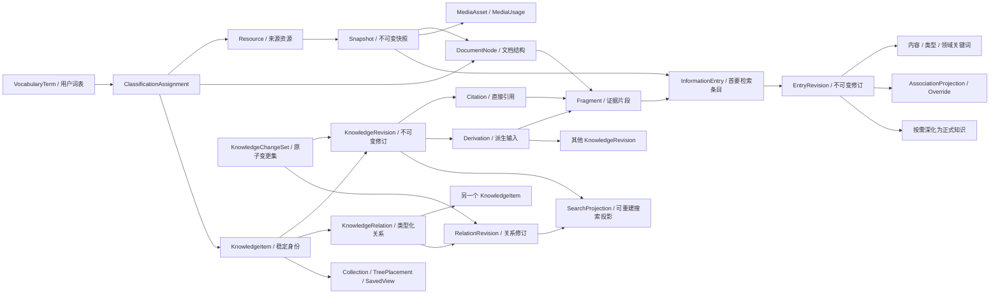

# StruInfo 知识核心架构

- 状态：M1C 七份迁移与知识闭环已冻结；当前按 ADR 0007 增加 Entry-first 文档处理与检索层
- 最近更新：2026-08-20
- 相关决策：[ADR 0005](adr/0005-versioned-knowledge-core-and-ai-optional-operations.md)、[ADR 0006](adr/0006-external-configuration-and-personal-data-isolation.md)、[ADR 0007](adr/0007-information-entry-first-document-processing.md)

## 1. 核心结论

StruInfo 的数据库不是“AI 生成内容的保存处”，也不是只有向量和聊天接口的 RAG 容器。
它在 PostgreSQL 中同时保存来源证据、首要检索条目和可选的正式语义知识。
`InformationEntry` 是普通文档处理、标注、关联和搜索的主单元；具有不可变修订和类型化
关系的 `KnowledgeItem`/`KnowledgeRelation` 继续承担需要稳定语义身份的正式知识。

系统先保证以下能力在完全没有 AI 供应商、模型凭据、Embedding 或自然语言回答时仍然成立：

- 保存来源、快照、原文结构、图片位置和稳定证据；
- 由用户或确定性解析器分类、拆分、编辑和创建知识；
- 建立、修订、撤回和审核类型化关系；
- 把既有知识组合成框架、集合、树视图和时间线，而不复制正文；
- 按标题、正文、别名、类型、来源、时间、关系和状态检索；
- 查看历史、证据、派生、冲突、变更集和操作来源；
- 导入、导出、备份、恢复和在不依赖 AI 的情况下继续维护。

AI 可以显著降低拆分、摘要、实体识别、关系发现、冲突核验和查询综合的人工成本，但它只能生成与手工或规则处理相同格式的提案，不能成为数据库正确性或基本可用性的前提。

## 2. 四类数据与三类派生物

| 类别         | 主要内容                                                           | 是否为规范事实                                           |
| ------------ | ------------------------------------------------------------------ | -------------------------------------------------------- |
| 证据         | `Resource`、不可变 `Snapshot`、Blob、获取身份和内容哈希            | 是；表示系统实际保存或引用了什么                         |
| 文档结构     | `DocumentNode`、`Fragment`、`MediaAsset`、`MediaUsage` 和原始顺序  | 是；表示证据内部实际如何组织                             |
| 信息条目     | `InformationEntry`、不可变修订、三维关键词和拆分/合并沿袭          | 是；表示用户实际浏览、标注、搜索和关联的来源绑定单元     |
| 正式知识     | 稳定知识项、不可变修订、别名、关系、引用、派生和冲突               | 是；表示当前接受并保留历史的知识状态                     |
| 用户控制数据 | 分类词表、准入动作、审核、集合、树位置、保存查询、偏好、策略和布局 | 是；表示用户如何组织和控制自己的工作区，但不等于知识语义 |
| 搜索投影     | 规范化文本、词项倒排、`pg_trgm`、关系邻域、可选向量和排序字段      | 否；可以从规范数据重建                                   |
| 导航投影     | 由树位置解析出的树、图布局、时间线分组、列表和看板                 | 否；不是知识语义本身                                     |
| AI 产物      | 摘要、提案、候选关系、查询综合和规则建议                           | 否；授权提交后产生的正式修订才属于知识                   |
| 关联投影     | Entry 相似度分项、基础分、候选排名和算法版本                       | 否；可重建，但人工 `AssociationOverride` 是规范控制数据  |

证据、文档、知识和控制数据不能互相覆盖。例如，删除一个树位置不会删除知识；修改分类不会改写来源；模型建议一个关系不会立即使关系成立。

## 3. 规范对象关系



逻辑层次不要求拆成多个 PostgreSQL 服务或图数据库。第一版继续使用一个 PostgreSQL 数据库和一个应用 schema，由模块仓储拥有各自表；跨模块修改只能通过应用用例完成。

### 3.1 Fragment、Entry 与 Knowledge 的边界

三者是有向深化关系，不是同一对象的三个名称：

| 对象               | 回答的问题                                                   | 变更规则                                     |
| ------------------ | ------------------------------------------------------------ | -------------------------------------------- |
| `Fragment`         | 原始 Snapshot 的哪个精确位置提供了证据？                     | 随 Snapshot 不可变                           |
| `InformationEntry` | 用户要浏览、标注、连接和找回的文档单元是什么？               | 稳定身份加不可变修订；可拆分、合并并保留沿袭 |
| `KnowledgeItem`    | 哪个概念、观点、事件、方法或资源需要稳定语义身份和正式历史？ | 通过既有知识命令追加不可变修订               |

一个 Entry 可以引用一个或多个 Fragment；一个 Fragment 也可以参与多个后续 Entry
修订。一个 Entry 可以不形成正式知识，也可以作为一个或多个 KnowledgeRevision 的证据或
派生输入。正式知识不能因为关联到 Entry 就失去自身的审核、来源和关系语义。

Entry 的内容、类型和领域关键词服务于文档组织和相似发现；它们不等同于
`ContentClassification`、`KnowledgeKind`、`EpistemicRole` 或
`KnowledgeRelation`。Entry 的“可能相关”关联也不能冒充 `supports`、
`contradicts` 或 `part_of`。

## 4. 必须分开的六个维度

阶段 0 的人工审核暴露了一个建模错误：内容类型曾被填入处理动作字段。具体人工值已移至仓库外的用户文档；规范模型只记录由此确认的通用规则——内容分类不是处理动作。系统必须分别保存以下维度。

| 维度                    | 示例                                                               | 所有者与用途                         |
| ----------------------- | ------------------------------------------------------------------ | ------------------------------------ |
| `ContentClassification` | 小说、论文、教程、广告、工具介绍、周刊条目                         | 用户工作区词表；回答“它属于什么”     |
| `IntakeAction`          | 完整处理、拆分、压缩、仅保留来源、忽略、待审核                     | 系统工作流动作；回答“现在如何处理”   |
| `KnowledgeKind`         | 新写入：概念、观点、事件、方法、资源、其他；兼容旧实体、框架、作品 | 知识结构类型；回答“形成什么知识”     |
| `EpistemicRole`         | 来源原文所述、从来源整理、根据来源推断、用户补充判断               | 形成方式；回答“这条内容是怎样形成的” |
| `ReviewState`           | 草稿、待审核、已确认、有争议、被驳回、已撤回                       | 生命周期；回答“当前是否被接受”       |
| `OperationOrigin`       | 用户手工、确定性解析、声明式规则、确定性导入、AI 提案、外部客户端  | 审计来源；回答“这次变化由什么产生”   |

`ContentClassification` 使用版本化、可扩展的用户词表。“小说”可以由用户新增、重命名或形成子类，不应作为 TypeScript 枚举硬编码。`IntakeAction`、`ReviewState` 和少量系统级 `EpistemicRole` 属于协议状态机，可以由程序固定，因为它们决定校验和权限，而不是表达个人偏好。

实际审核交互继续遵守该分离：`有用程度` 写入 `information_density`，`有趣程度`
写入 `current_interest`；它们只可生成可覆盖的处理建议，不能隐式改写 `IntakeAction`。
`IntakeAction` 记录审核当时的倾向，知识形成器仍按 Fragment 长度、内部结构、媒体用途和
用户规则派生实际处理计划。短条目默认形成单项；只有正文和结构都足够时才执行拆分。
用户自定义快捷标记在用户确认后创建为当前外部工作区的 `VocabularyTerm`，不是代码
seed 或新的系统枚举。快捷栏本身是数据根 `preferences/` 下按工作区隔离的个人 UI 配置，
不属于领域 Bundle；增删快捷栏不会修改既有词条或审核。无 AI 的关键词提取只产生可编辑
候选：链接目标、路径和文件名默认在提取前剥离，链接标题仍可表达语义；用户可在外部
工作区偏好中关闭自动提取、显式允许 URL 域名或维护精确排除词。只有提交时仍保留的候选
才进入分类命令，关闭开关不会删除手工或既有分类。用户可以拒绝自动联系或记录
明确目标。正式 KnowledgeItem 尚不存在时，联系选择作为版本化审核备注中的处理意图保存，
不冒充 `KnowledgeRelation`；正式关系仍只能由知识变更命令创建。

审核与正式知识之间使用一个显式、可恢复的队列，而不是把两个状态合并：队列从当前
`CurationTarget`/`IntakeDecision` 重建，只接收 `full`、`split`、`condense` 三类准入
结果；知识是否已经形成则只由当前 `KnowledgeRevision` 的精确 Fragment 来源通过确定性
搜索判定。短条目可直接形成一个可编辑知识项；只有长度和结构确实需要时才进入多项拆分。
成功提交后必须通过公开搜索端口回读并显示“已可检索”，搜索暂时失败时仍应诚实保留“写入
已成功、验证待刷新”的区别，不能诱导用户重复提交。该队列只是现有 Curation、Knowledge
和 Retrieval 边界的产品编排，不引入第二套知识状态、批处理表或 AI 隐式权限。

网页把协议字段 `EpistemicRole` 显示为“内容如何形成”，而不暴露难懂的“内容角色”或
“认识论角色”：`source_claim` 表示来源原文直接陈述，`summary` 表示从来源压缩整理，
`inference` 表示依据来源进一步推断，`user_assertion` 表示用户补充判断。该名称调整不改变
数据库值。队列写入后保留“返回上一条”；对本次页面会话内由快速队列创建的知识，修改复用
稳定 `KnowledgeItem` 身份并追加下一条 `KnowledgeRevision`，绝不原地覆盖历史。页面无法
从搜索结果完整重建来源链时，必须先通过工作区限定的当前知识读取端口取得所选 Item 的
完整值、隐私事实、Fragment 引用/派生和历史知识派生，再预填高级编辑器；不能用一个简化
搜索结果替换未知 provenance。高级保存仍走同一追加式知识命令。

## 5. 知识数据模型

### 5.1 稳定身份与不可变修订

`KnowledgeItem` 只承担稳定身份、工作区边界和当前修订指针。标题、正文、类型、时间和状态等可变化语义进入 `KnowledgeRevision`。

每次有效编辑创建新修订：

- 旧修订不原地覆盖；
- 当前修订指针与变更集在同一事务更新；
- 引用绑定具体修订，语义变化后必须重新核验；
- 撤回使用补偿修订和 `supersedes`/`reverted_by` 关系；
- 隐私删除与知识撤回是两种不同操作，前者按保留策略撤销访问并最终清理字节。

隐私文档使用规范数据中的显式、可查询事实，而不是前端临时标签。`Resource.is_private`
标记整个来源文档；`KnowledgeRevision.is_private` 与
`RelationRevision.is_private` 固化该修订的隐私传播结果。首版传播是单调的：来自隐私
Fragment、隐私历史修订或既有隐私修订的知识保持隐私；关系使用隐私证据或任一当前端点
为隐私时也保持隐私。解除隐私必须是未来独立、可审计的显式命令，普通编辑不能顺带完成。

### 5.2 类型与可扩展字段

核心表保存稳定且经常查询的字段，例如工作区、类型、状态、语言、时间范围、当前修订、归属者和版本。低频且随知识类型变化的字段可以进入带 schema 版本的受验证 `jsonb` payload，但不能把整个数据库退化为无约束 EAV 或任意 JSON 文档库。

用户分类、主题、领域和自定义标签通过 `VocabularyTerm` 与 `ClassificationAssignment` 建模。词表记录稳定 key、显示名、父词条、版本、适用对象和退役状态；重命名显示名不改变历史引用。首个证据目标实现由 [`C-SLICE-A-CURATION-r3`](manual-curation-contract.md) 冻结并归 `curation` 模块所有；未来对正式 `KnowledgeItem` 的分类只复用其词表读取边界，由知识核心命令拥有指派，不能让两个模块共同写同一行。

### 5.3 别名、同一性与合并

`KnowledgeAlias` 保存名称、语言、规范化形式和适用范围。名称相同只产生同一性候选，不自动合并。

在正式 `KnowledgeAlias` 投影实现前，M1C 使用包体外工作区偏好保存轻量词表整理规则：
大小写身份直接复用现有词条；中英文等价写法由用户确认为别名；包含或语义相近的词只作为
候选，由用户选择翻译提示、相关提示或合并。显式合并会把当前分类迁移到保留词条并退役
来源词条，历史修订不删除。该偏好还可把任一用户词条映射到通用 `KnowledgeKind`，例如
`work`；真实标签名称不进入源码。词表提示不是正式 `KnowledgeRelation`，后续投影可以从
这些外部规则和已确认领域事实重建。

合并两个知识项属于高影响命令：

- 选择保留的稳定 ID；
- 保留被合并 ID 的重定向和历史；
- 显式迁移或保留关系、分类和树位置；
- 生成可审核的变更集；
- 不删除旧证据或修订。

### 5.4 关系

`KnowledgeRelation` 只保存稳定关系身份、工作区和当前修订指针；`RelationRevision` 保存某次关系陈述的主体、关系类型、客体、方向、限定条件、认知角色、审核状态、有效时间和依据。改变任一端点或谓词通常创建新关系；只有在纠错并保留同一业务身份确有价值时才修订原关系。

关系必须：

- 有方向和明确类型；
- 可以有多个相互独立或冲突的来源；
- 可以被修订、撤回或标记有争议；
- 支持条件、范围和时间，而不是把所有关系压成永久事实；
- 与 `TreePlacement` 分离；树的父子关系不会自动创建 `is_a` 或 `part_of`。

关系类型可以由版本化词表扩展，但具有权限或算法语义的系统关系必须由迁移和代码审查引入，不能通过个人配置改变安全行为。

### 5.5 引用与派生

`Citation` 表示某个知识或关系修订直接依赖哪个 `Fragment`。`Derivation` 表示总结、推断、组合或规则结果由哪些片段、修订、处理运行或规则版本产生。

直接引用与派生不可互换：AI 总结可以由多个来源派生，但不能因此声称每个句子都是某一来源原话。

### 5.6 组合与重组

重组知识不应复制原正文：

- `Collection` 保存有序或无序的知识引用；
- `TreePlacement` 把同一知识放到多个导航位置；
- `SavedView` 保存查询条件、排序和展示配置；
- `Framework` 类型的知识修订可以通过成员关系组合多个概念、方法和断言；
- 新的综合文章或说明是一个新修订，并通过 `Derivation` 指向所使用的知识和证据。

因此，“拆分”产生较小的正式单元，“连接”产生类型化关系，“重组”产生引用既有单元的集合、框架或派生修订；三者都不会破坏原始来源。

### 5.7 关系表族

第一版按模块组织普通关系表，而不是建立一个万能节点表：

| 表族                 | 代表对象                                                                            | 关键约束                                                      |
| -------------------- | ----------------------------------------------------------------------------------- | ------------------------------------------------------------- |
| `evidence`           | Resource、Snapshot、DocumentNode、Fragment、MediaAsset/Usage                        | Snapshot 和证据定位不可变；Blob 以内容哈希校验                |
| `vocabulary`         | VocabularyTerm、VocabularyRevision、ClassificationAssignment                        | 词条 key 稳定；显示名和层级可版本化；赋值保留历史             |
| `knowledge identity` | KnowledgeItem、KnowledgeAlias、KnowledgeRelation                                    | 稳定 ID、工作区范围、当前修订指针和合并重定向                 |
| `knowledge history`  | KnowledgeRevision、RelationRevision                                                 | 追加式修订；当前指针由同一事务推进                            |
| `provenance`         | RevisionCitation、RelationCitation、DerivationInput                                 | 使用真实外键指向精确修订和 Fragment，不用无法约束的多态字符串 |
| `change control`     | KnowledgeChangeSet、ChangeOperation、Candidate、ConflictCase                        | 幂等键、预期版本、授权依据、来源和审计一起提交                |
| `composition`        | Collection、CollectionMember、TreePlacement、SavedView                              | 只引用稳定知识 ID；删除视图不删除知识或证据                   |
| `retrieval`          | SearchProjection、TermPosting、RelationNeighborhoodProjection、可选 EmbeddingRecord | 记录输入修订和算法/模型版本，可整体删除重建                   |

所有业务主键都和 `workspace_id` 一起进入唯一约束、外键解析和查询条件。跨表“任意对象”引用优先拆成带真实外键的专用连接表；只有公共协议明确需要并能在应用层完整验证时，才使用带对象类型的通用引用。

## 6. 所有知识变化使用同一命令边界

知识模块提供明确命令，而不是允许调用者直接修改表：

- 创建知识项或新修订；
- 设置内容分类和知识类型；
- 添加、退役别名；
- 创建、修订或撤回关系；
- 拆分文档单元或知识项；
- 创建集合、框架和树位置；
- 标记替代、重复、过期或冲突；
- 合并、撤回、补偿和重新处理；
- 导入或应用一个完整 `KnowledgeChangeSet`。

每个命令都需要工作区、预期版本、操作来源、授权依据和幂等身份。命令先生成或接收结构化变更操作，再由知识模块核验引用、类型、关系端点、并发版本和权限后原子提交。

调用者可以是：

1. 网页中的用户手工操作；
2. Markdown、CSV、JSON 等确定性导入器；
3. 用户启用的声明式规则；
4. AI/OCR 适配器生成的提案；Embedding 适配器只构建检索投影；
5. 将来经授权的外部项目。

来源不同不会产生第二套数据库写入逻辑。AI 没有特殊的“直接入库通道”。

## 7. 完全不依赖 AI 的操作模式

| 能力     | 无 AI 时的正式行为                                                           | AI 只提供的增强                        |
| -------- | ---------------------------------------------------------------------------- | -------------------------------------- |
| 摄取     | 手工文本/文件导入、Git/Markdown 确定性解析、原文与结构保存                   | 自动文档类型判断、复杂格式抽取建议     |
| 分类     | 用户选择工作区词表；规则按来源、路径、栏目或正则分类                         | 多维内容分类建议                       |
| 拆分     | 用户按标题、列表项、选区或行号建立单元；解析器按明确语法拆分                 | 语义边界和粒度建议                     |
| 创建知识 | 日常表单创建概念、观点、事件、方法、资源或其他                               | 自动提取和批量提案                     |
| 建立联系 | 用户选择关系类型；规则基于稳定 ID、明确别名或导入映射                        | 相似项、潜在关系和冲突建议             |
| 重组     | 集合、树位置、保存查询、框架成员和手工综合修订                               | 自动提纲、摘要与框架建议               |
| 搜索     | 结构化过滤、精确/别名、子串、`pg_trgm`、确定性词项倒排、关系遍历、来源和时间 | 向量召回、查询扩展和带引用自然语言综合 |
| 维护     | 手工修订、撤回、冲突登记、合并审核和批量规则                                 | 过期、重复和局部结构优化建议           |
| 导出     | 版本化 JSON/清单、证据引用和 Blob 包                                         | 可选自然语言报告                       |

没有配置 AI Provider 时，系统应显示“AI 增强未启用”，而不是把导入、编辑、关联或搜索标记为失败。默认测试和 CI 使用无 AI 模式；真实模型只做显式启用的附加验证。

切片 0 已固定[工作区 Bundle v1 信封](workspace-bundle-contract.md)的规范编码、分区 codec、Blob 引用和秘密排除边界。各知识模块仍须为自己的正式分区提供闭合 schema 和引用校验；通用信封 payload 不是任意 JSON 知识存储。

## 8. 搜索组织

检索由可解释、可单独关闭和可重建的通道组成。普通文档查询先以 Entry 为主，正式知识
查询作为可并列或后续深化的通道：

1. 解析 Entry 结构化条件：工作区、内容/类型/领域关键词、来源、文档、时间、拆分方式和可见范围；
2. 对当前 Entry 正文、标题路径和内容关键词执行精确、Unicode 子串和本地模糊匹配；
3. 在已保存 Entry 之间按选择性关联分和有界邻域提供可解释的“相关内容”；
4. 对正式知识继续解析知识类型、内容分类、状态、来源、时间和正式关系条件；
5. 对正式知识稳定 ID、标题、别名、当前修订、文档片段和用户笔记执行精确、Unicode 子串及 `pg_trgm` 检索；
6. 在真实中文语料证明必要且分词器通过依赖准入后，使用版本化的确定性分词规则构建词项投影；
7. 使用版本化、工作区可配置的确定性融合策略合并已启用通道，并返回各通道贡献、命中的字段/关键词和经过的关联或正式关系；
8. 有真实指标后，可增加 pgvector 召回；
9. 用户启用 AI 后，可对已经找回的结果进行查询扩展和带引用综合。

所有通道先应用同一隐私范围。默认范围在排序、计数、关系邻域和分页之前排除隐私知识
及涉及隐私端点的关系；显式 `includePrivate` 才扩大范围。普通范围与隐私范围使用不同的
查询摘要，因此游标不能跨范围复用。隐私文档完整规范化正文作为独立结果通道返回摘要，
用户再次明确查看后才读取全文；拆分条目不会替代或删除该全文副本。

`SearchProjection` 保存当前修订的规范化标题、别名、可检索正文、来源键和策略版本；`TermPosting` 保存可重建词项位置与频率；`RelationNeighborhoodProjection` 缓存从已接受关系推导的有界邻域。三者都必须能从规范数据重建，删除投影不会删除知识。Embedding 同样是记录模型、输入修订和算法版本的派生数据，不是知识本身。

第一版中文搜索以原文子串、别名、结构化过滤、真实语料 `pg_trgm` 基准和已接受关系遍历为准，不在没有测量前选择中文分词器或独立搜索服务。非精确搜索和联想因此不依赖 RAG：RAG 只是在可选 AI 层使用这些检索结果生成带引用回答，不能替代检索投影、正式关系或证据。

## 9. 数据库特性与不变量

第一版继续使用 PostgreSQL 18、普通关系表和邻接关系，不增加图数据库、向量数据库或独立搜索服务。

必须具备：

- 每条个人业务记录显式携带 `workspace_id`，并进入查询、唯一约束、缓存和幂等范围；
- 快照、知识修订和关系修订不可原地覆盖；
- 当前指针、变更操作、审计和 outbox 在一个事务提交；
- 所有外部重试写入具备原子幂等语义；
- 引用指向精确修订和精确 Fragment；
- Blob 使用内容寻址并与 PostgreSQL 元数据一起备份和校验；
- 树、图布局、向量和搜索索引可完全重建；
- 冲突陈述可以并存，不能用最后写入静默覆盖；
- 个人词表和分类可扩展，但不能修改协议状态机或权限语义；
- 所有 AI 字段均可为空，未启用 AI 不破坏约束。
- 隐私来源、隐私知识修订和隐私关系修订是工作区规范事实；默认查询必须在计数和关系遍历前排除它们，且关系端点隐私动态参与判断。

## 10. 工程代码、运行配置和个人数据隔离

```text
应用安装/镜像
  ├─ 程序代码、迁移、契约、配置 schema、无真实值示例
  └─ 不含个人知识、偏好、词表、规则、凭据、快照或导出

外部运行配置
  └─ 数据库地址、监听地址、外部数据根、功能开关和秘密引用

PostgreSQL 工作区数据
  └─ 知识、分类词表、偏好、策略、来源、保存查询和审计

外部 Blob/Data Root
  └─ 快照、隐私文档完整原始/规范化字节、图片、附件、导出和备份；不位于源码仓库或安装目录

外部秘密存储
  └─ 数据库、AI、Webhook 等凭据；工作区记录只保存引用
```

个人分类“小说”、知识正文、偏好评分、探索策略、信源订阅、保存查询、UI 布局和用户提示词都属于工作区数据。它们不得作为 TypeScript 常量、默认 fixture、迁移 seed、前端 mock、构建资源或容器镜像内容出现。

代码可以固定数据库协议、状态机、权限规则、字段校验和合成测试数据。仓库可以保存没有真实值的配置 schema 与示例，但实际运行配置、个人配置和数据必须从包体外加载。

应用模块只依赖稳定协议和可替换端口，不直接依赖个人文件：

```text
同一应用构建
  └─ composition / typed ports
       ├─ 包体外运行配置与秘密引用 ──> PostgreSQL / Blob adapters
       ├─ 稳定 workspace_id ─────────> 工作区范围的 repository
       └─ 版本化 Workspace Bundle ───> 校验后的导入 / 导出命令
```

更换个人资料集的正式方式是切换稳定工作区，或把外部 Bundle 验证并导入目标工作区，而不是替换源码目录中的“记忆模块”。同一构建必须能打开多个相互隔离的外部工作区；知识、偏好、词表、信源和提示覆盖的变化不触发重新编译。

首版可以通过受控重启或关闭并重新打开 composition root 完成运行配置/工作区切换，不要求文件监视器。切换必须先验证完整候选配置、数据库连接、数据根和工作区身份，再一次性激活；失败不能留下数据库来自 A、Blob 根来自 B 的混合状态。Bundle 始终是可移植数据载体，不作为直接在线存储或可执行插件。

证据 Resource 的 `source_key` 是 adapter-owned、deterministic、portable opaque identity。
盘符路径、UNC/rooted path、POSIX 绝对路径、Windows 反斜杠形式或 traversal segment 不得成为持久身份。
本地文件适配器应使用上传登记 ID、适配器记录 ID、内容身份或其他可移植 key。
若未来必须保留原始本地路径，应定义独立的私有 typed locator 及导出和日志脱敏规则，不能把路径重载到 `source_key`。

Windows 本地运行和 Linux 部署都必须使用源码/安装目录之外的数据根。启动时规范化真实路径并拒绝把个人数据根、Blob 根、导出或备份目录放在仓库、应用安装目录或只读包体内部。容器部署使用外部卷或对象存储，不能把数据写入镜像层。

候选应用包通过[制品边界](application-artifact-boundary.md)实际枚举并生成哈希清单；被 Git 忽略不代表可以进入包体。容器镜像仍在独立准入门中验证，当前结果不能被描述为镜像或发布许可已经完成。

## 11. 首个实现顺序

领域与持久化基础已经具备：外部配置与数据根、Evidence/Markdown、Curation、
Knowledge 和 Retrieval 的纯逻辑实现、四类 PostgreSQL repository adapter 以及
`000001`–`000007` 前向迁移均已实现。后续不再按“再写一份合同、再扩大一轮
oracle”的方式推进，而按一条可运行纵向路径接线：

1. **已完成**：Evidence PostgreSQL repository 将 Markdown 原始 Blob、来源、
   Snapshot、文档结构、Fragment 和媒体引用作为一个导入用例持久化；
2. **已完成**：同一构建通过两个包体外合成工作区配置完成切换、重开和 Blob/数据库
   隔离验证，不需要修改源码或重新构建；
3. **已完成功能 smoke**：disposable PostgreSQL 18 已实际执行全部六份迁移并完成
   Evidence 写入、重放、冲突和重启；真实浏览器还完成
   Curation/Knowledge/Retrieval 的联合合成功能流。`000006` 的独立小型 smoke 进一步
   验证隐私文档原始/规范化备份、知识与关系传播、默认隐藏和显式查询。正式 TM2 认证
   不作为这些功能 smoke 的前置条件；
4. **已完成**：提供只覆盖导入、证据查看、人工分类/准入、知识变更和搜索的应用服务
   与 HTTP 入口，不先建设通用外部 API、WebSocket 或后台任务平台；
5. **已完成**：资料/证据、快速审核、知识维护、搜索/出处四个工作区已用固定 issue 405
   完成 Git 来源导入、人工决定、知识与关系写入、Framework 重组、撤回修订和精确出处
   返回；
6. **已完成**：使用现有 `framework` 知识类型和 knowledge-revision derivation 引用
   两个既有修订完成最小重组，没有等待 Collection、TreePlacement 或 SavedView；
7. **已完成**：同一导入路径已处理固定十期，保存 10 个 Snapshot、2,639 个正式
   Fragment 并返回 345 个审核单元；当前 36 张领域表可规范导出到外部 Bundle，并在
   同一 `workspaceId` 的空数据库中原子恢复，Blob 字节仍由外部内容寻址存储单独保管；
8. **已完成**：Evidence 读模型通过 Fragment 的持久化 Node 身份返回 `nodeKind`，网页
   只把 `section` Fragment 作为可恢复审核单元；当前来源进度、逐条前进、提交后继续和
   精确原文入口不依赖导入进程内 receipt。真实 PostgreSQL 18 的十期读模型与恢复库均
   得到 2,639 个 Fragment、345 个审核单元；
9. **已完成**：录入可显式标记隐私文档，完整原始和规范化
   正文保存在外部 Blob，派生知识与涉及隐私端点的关系传播隐私；默认检索排除它们，
   只有当次显式勾选“查询隐私文档”才返回隐私知识、关系和单独的完整文档结果；该路径
   已在从空库执行六份迁移的 disposable PostgreSQL 18 上通过；
10. **已完成**：首轮真实审核暴露的操作阻碍已通过快速审核工作台关闭；两个独立评分、
    可覆盖的处理建议、既有原因、工作区快捷词条、可编辑关键词和联系意图可在同一条目上
    提交，随后自动前进；返回上一条会从持久化状态恢复，正式知识变更集移到独立知识维护页；
11. **已完成**：两个评分在界面明确为五档；审核工作区按内容自然增长并使用正常纵向
    滚动，避免固定单视口遮挡评价、标签、联系或提交操作。个人快捷标记通过本地 HTTP
    写入外部数据根的工作区偏好文件，可新增和移除，未引入迁移或硬编码个人词表；
12. **已完成**：知识维护页从审核状态重建逐条转知识队列，按长度/结构计划预填短条目，
    复用已有 eligible-target 知识命令提交；随后用 Snapshot 来源过滤重新搜索当前修订，
    显示已形成的知识并自动前进。高级拆分、关系和历史修订仍由同一知识编辑器处理；
13. **已完成**：既有正式知识通过工作区限定的当前 Item 读取端口把当前值、修订身份、
    隐私事实和完整 provenance 装入高级编辑器；保存继续追加不可变修订，不从搜索卡片猜测
    或丢弃来源；
14. **已完成**：日常新知识写入收敛为概念、观点、事件、方法、资源、其他六类；旧
    `entity`、`framework`、`work` 修订不迁移，界面统一作为资源显示，资源筛选同时覆盖
    这些旧值。`assertion` 保持存储值但显示为观点，`000007` 仅为新写入增加 `other`；
    来源支持的新条目默认标记为来源原文所述，审核状态逻辑未改变；
15. **已完成 M1D-0**：冻结 M1C，不重写现有 Evidence、Curation 或 Knowledge 数据；
    ADR 0007 固定 Entry-first 路径及兼容边界；
16. **已完成 M1D-1**：通过 `000008` 和窄应用端口从已有 Snapshot 生成稳定 Entry，允许
    人工设置内容、类型和领域关键词，并通过本地 HTTP/Web 按正文或关键词搜索且返回来源；
17. **已完成 M1D-2**：`000009` 以既有 Snapshot 作为 Document 身份，保存版本化文档
    标签；确定性聚合按全文命中频次排序并记录 Entry 覆盖数，人工编辑追加独立修订。
    本地 API/Web 已提供 Document ↔ Entry 双向导航、完整来源入口和隐私显式查看；
    `struinfo.m1d-entry.v1` 把 6 张 Entry 表和 3 张文档标签表加入同一外部 Bundle，和既有
    36 表分区在一次一致快照中导出、一次事务中恢复；旧 Bundle 仍映射为空 Entry 状态；
18. **已完成 M1D-3**：`000010` 保存可重建的选择性关联投影与独立的追加式人工 override；
    版本化本地策略先以内容关键词和正文词项缩小候选，再分别计算内容、类型和领域分数。
    本地 API/Web 已提供重建、解释、来源和增强/削弱/屏蔽/恢复，隐私范围先于关联可见性；
    issue 398 的 34 个 Entry 确定性得到 7 个关联对，覆盖 6 个 Entry；
19. **已完成 M1D-4**：无新增迁移地组合 Entry 正文、关键词、来源、Snapshot、类型、领域、
    拆分方式、发布时间/采集时间、隐私与最多两跳的关联邻域；查询绑定排他游标提供稳定分页，
    每条结果返回文本、结构和路径解释。隐私先于计数、候选、遍历、排序和分页；外部工作区
    34 个 Entry 的实测延迟不支持增加 `pg_trgm`、词项投影、SQL 查询下推或额外索引；
20. **当前 M1D-5**：把关联投影与人工 override 加入独立 Bundle 分区，并由用户选择其余
    Snapshot 完成批量 Entry 构建、搜索、关联、回退和隐私检查；
21. **M1E**：再把 AI 处理器接到同一个 Entry/知识提案边界，最后考虑向量、RAG、自然
    语言综合、偏好学习和自动维护。

偏好校准可以继续积累，但它不再阻塞第 1–12 步，也不能决定知识数据库的基本结构。

## 12. 验收问题

在接入真实 AI 之前，固定语料必须能够证明：

- “小说”被保存为内容分类，同时处理动作可以独立保持未决定；
- 文档 Entry 可在不创建 KnowledgeItem 的情况下设置三类关键词、建立可解释关联并被搜索；
- Entry、Fragment 和 KnowledgeItem 可以互相返回来源，但不会共享或混淆身份；
- 用户能够把一个主文拆成多个知识项，并返回原文行号；
- 用户能够建立和撤回一条类型化关系，而不改写两个端点；
- 用户能够把同一知识放入两个集合或树位置而不复制修订；
- 用户能够创建一个由多项知识派生的框架并查看全部依据；
- 编辑产生新修订，旧引用不会被静默继承；
- 搜索能够按中文子串、别名、分类、来源、时间和关系找回目标，并解释每个结果来自哪些确定性通道；
- 在没有任何 AI 配置时，摄取、编辑、维护、搜索、导出和恢复全部可用；
- 仓库、构建包和容器镜像中不存在个人知识、偏好、配置或真实快照。
